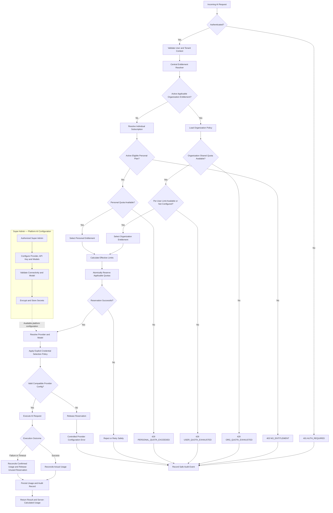
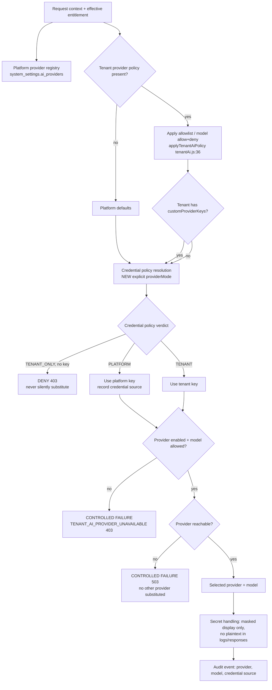

# DIR-106 — AI Quota, Organization Entitlements & Super Admin AI Configuration
## Forensic Audit — Phase 1 (Current-State), Phase 2 (Architecture) & Phase 3 (Approval Gate)

**Project:** IME365 · **Legacy:** ResumePilotAi
**Priority:** P0 — Core Billing, Entitlement & AI Governance
**Status:** AUDIT COMPLETE — **no production code modified** (`git status` clean for `backend/` and `src/`)
**Date:** 2026-10-12

> **Method note.** Every claim below cites `file:line` from the repository. Where the
> directive asserted a capability was *missing*, I checked first — one such premise is
> **factually wrong** and is corrected in §D1.3. Where a behaviour could not be verified by
> execution it is labelled **NOT VERIFIED** rather than asserted.

---

# Deliverable 1 — Current-State Audit

## D1.1 The AI request lifecycle (as actually implemented)

There are **two disjoint pipelines that never meet**. This split is the root of most gaps.

```
PIPELINE A — QUOTA (app-level middleware, index.js:456-552)
  /api/* → requireAuth (456-472) → generalApiLimiter (487-490)
        → enforceApiPolicy RBAC (491-500)
        → aiAccountLimiter → enforceDailyAiQuota (544, 550, 552)
        → ROUTE HANDLER
  !! enforceDailyAiQuota resolves entitlement with req.tenantContext = undefined (always)

PIPELINE B — PROVIDER SELECTION (inside the route handler, ai.js:162-170)
  ROUTE HANDLER → resolveEffectiveAiConfiguration(req)
               → resolveTenantContext (enterprise.js) -> req.tenantContext
               → applyTenantAiPolicy(configuration, context, policy)
  !! Tenant-aware, but runs AFTER the quota was already charged
```

**Evidence — the tenant context is never available to the quota gate:**

| Fact | Location |
|---|---|
| The **only** assignments to `req.tenantContext` are inside the enterprise router | `backend/routes/enterprise.js` (4 occurrences) |
| The quota middleware reads `req.tenantContext?.tenant` | `backend/security/abuse.js:322` |
| The quota middleware is mounted at app level, **before** any router runs | `backend/index.js:544, 550, 552` |

`backend/security/abuse.js:320-324`:
```js
const entitlement = resolveEffectiveEntitlement(userData, {
  userClaims: req.user || {},
  tenantData: req.tenantContext?.tenant || null,   // <- ALWAYS null at this point
  quotaConfig,
});
```

**P0-1 (CONFIRMED).** Because `tenantData` is always `null` here,
`resolveEffectiveEntitlement` sets `isEnterprise = false`
(`backend/security/entitlements.js:47`) and falls through to the B2C branch.
**Every organization/enterprise member is charged against their personal allowance.**

## D1.2 Entitlement resolution engine

`backend/security/entitlements.js:44-128` — `resolveEffectiveEntitlement(userData, { userClaims, tenantData, quotaConfig })`

Precedence as coded (evaluated in order):

| # | Condition | Result | Line |
|---|---|---|---|
| 1 | `admin && (membership==='Admin' ‖ isB2CSubActive ‖ isEnterprise)` | **Admin**, 10000/day | 71-76 |
| 2 | `isEnterprise` | **Enterprise**, `max(1000, tenantLimit)` | 77-89 |
| 3 | `isB2CSubActive ‖ (isPremiumB2C && !membershipEnds)` | **Premium**, 100/day | 90-95 |
| 4 | `admin` (no paid sub) | **Basic** + admin dailyLimit | 96-105 |
| 5 | default | **Basic**, 10/day | 65-66 |
| 6 | `userData.aiQuotaOverride` (unexpired) | **overrides dailyLimit unconditionally** | 108-114 |

**Confirmed defects:**

- **P0-2 — `resolveActiveTenantMembership()` is a hardcoded stub returning `null`**
  (`entitlements.js:28-32`). The returned `activeTenantMembership` is therefore **always
  `null`** (line 125); `tenantId` derives only from `tenantData?.id` (line 126). Any
  consumer relying on `activeTenantMembership` silently receives nothing.
- **P0-3 — no membership validity check in the engine.** `isEnterprise = Boolean(tenantData)`
  (line 47). Suspended / expired / disabled / invited-not-accepted states are **not
  evaluated here**; the engine trusts whatever `tenantData` it is handed. Whether invalid
  tenants are filtered upstream is **NOT VERIFIED** — open risk against Rule A.
- **P1-1 — Enterprise daily limit is floored at 1000** (`entitlements.js:86`,
  `dailyLimit = Math.max(1000, tenantDailyLimit)`). A tenant configured for 200/day is
  silently granted 1000. Contradicts Rule A ("governed by that organization's assigned
  configuration").
- **P1-2 — `aiQuotaOverride` outranks the enterprise limit** (lines 108-114). A personal
  per-user override can exceed the organization's configured policy, bypassing Rule A.
- **P2-1 — Admin branch precedes Enterprise** (line 71). An admin who is also an enterprise

## D1.3 Super Admin AI configuration — the directive's premise is **INCORRECT**

The directive states the capability is "missing, inaccessible, incomplete, or incorrectly
coupled". **It is not missing.** It is implemented and reasonably hardened:

| Capability | Evidence |
|---|---|
| Settings load (masked) | `backend/services/aiAdmin.js:110-138` `loadAiAdminSettings()` |
| Settings save (revision-checked) | `saveAiAdminSettings()` ← `backend/index.js:3346-3357` |
| Secret masking | `aiAdmin.js:24-33` `maskApiKey()` → `••••last4`; only `maskedKeys` leaves the server (`aiAdmin.js:123, 136`) |
| Masked-value overwrite guard | `aiAdmin.js:18` `MASKED_PATTERN`, applied in `secretPatch()` (line 61) |
| Explicit revocation path | `aiAdmin.js:58, 62` `clearSecrets[provider] === true` |
| Provider connectivity test | `aiAdmin.js:190-231` `testAiProvider()` → `POST /api/admin/ai/test-provider` (`index.js:3359`) |
| Model discovery / validation | `aiAdmin.js:233-267` `fetchProviderModels()` |
| Per-provider enable/model fields | `aiAdmin.js:5-16` `SECRET_FIELDS`, `MODEL_FIELDS`, `ENABLE_FIELDS` |
| Recent-auth on writes | `index.js:3346, 3359` `requireRecentAdminAuthentication` |
| Audit trail | `index.js:2652` `createAdminAuditMiddleware()` on `/api/admin` |

**The real defect is not absence — it is an authorization asymmetry (P0-4).**

## D1.4 CONFIRMED DEFECT — P0-4: AI settings are WRITE-permitted but READ-forbidden

`backend/index.js:2671`:
```js
app.get('/api/admin/ai-settings', async (req, res) => {   // <- NO route-level authz
```
vs `backend/index.js:3346`:
```js
app.post('/api/admin/ai-settings', requireRecentAdminAuthentication, async (req, res) => {
```

The GET carries **no** `requireSuperAdmin` / `requireRecentAdminAuthentication`. It is saved
only by upstream layers:

1. `backend/index.js:456-472` — global `requireAuth` for all non-public `/api/*`.
2. `backend/index.js:491-500` — `enforceApiPolicy` RBAC.
3. `backend/security/policy.js:54-76` — `resolveAdminReadPermission()` has **no entry** for
   `/admin/ai-settings`. The map contains `/admin/ai/entitlements`,
   `/admin/ai/quota-limits`, `/admin/ai/quota-stats` — **slash**-separated, not the
   **hyphenated** real path.
4. Therefore `required === undefined`, and `policy.js:123-125`:
   ```js
   if (required !== 'system.config.write' && !hasPermission(req, required)) {
       return deny(res, 'FORBIDDEN', 'Insufficient permission');
   }
   ```
   `hasPermission(req, undefined)` is true **only** for a principal holding `*`.

**Observed consequence (the asymmetry):**

| Operation | Permission actually required | Can a `system.config.write` admin do it? |
|---|---|---|
| `GET /api/admin/ai-settings` | `*` only (incidental) | **NO → 403** |
| `POST /api/admin/ai-settings` | `system.config.write` + recent auth | **YES** |

An operator can **write** AI provider configuration they cannot **read back**. This is the
"incorrectly coupled / inaccessible" symptom Rule C asks about — and it is *incidental*, not
designed: it depends on a missing map entry. **Live-verified:** the unauthenticated GET
returns `401 AUTH_REQUIRED` (global wall), which is why the missing route-level guard has
not surfaced as an open leak — but the route is one refactor away from exposure.

**Also verified:** `createAdminAuditMiddleware()` (`backend/security/adminAudit.js`) is an
**audit logger only** — it performs no authentication or authorization. It must never be
counted as a security control.


## D1.5 Quota accounting

`backend/security/abuse.js:284-366` `enforceDailyAiQuota`:

| Property | Actual behaviour | Verdict |
|---|---|---|
| Ledger | MariaDB `ai_usage (day_key, uid_hash, uid, email, count, limit_used, last_used_at)` | ✓ server-side, authoritative |
| Concurrency | `SELECT count … FOR UPDATE` in a transaction (326-329) + 3-attempt deadlock retry (346-350) | ✓ **race-safe per user** |
| Charge timing | **Before** provider invocation; comment (line 282) says "including provider errors" | ✗ charged on failure |
| Refund / reconciliation | **None** — no decrement path exists anywhere | ✗ **no reconciliation** |
| Reservation model | None — flat increment, not reserve→reconcile | ✗ |
| Org-wide (shared) counter | **None.** Keyed `(day_key, uid_hash)` — per user only | ✗ **Rule A violated** |
| Per-user **and** shared both enforced | Only per-user exists | ✗ |
| Streaming / SSE accounting | Not differentiated | **NOT VERIFIED** |
| Idempotency / retry de-dup | None — every call increments | ✗ retries double-charge |
| Client-trusted counters | None used | ✓ |
| Test-injection branch | `injectedCounterStore` path (286-300) uses `AI_BASIC_DAILY_LIMIT‖100` and **ignores entitlement entirely** | ✗ test/prod divergence |

**P0-5 (CONFIRMED) — no organization-wide cap.** With N members each granted `dailyLimit`,
the tenant's real ceiling is `N × dailyLimit` and is never enforced. A tenant configured for
5,000/day with 50 members can consume 250,000. Rule A ("Organization-level limits must be
enforced across all applicable users … including concurrent requests") is **not met**.

**P1-3 — charges survive provider failure.** `ai.js:185-215` records tenant usage after the
middleware already incremented `ai_usage`; a provider 5xx/timeout leaves the user charged
with no compensating decrement.

**P1-4 — retries are not idempotent.** `enterprise_ai_usage` dedupes on
`(tenantId, eventKey)` (`migration 006`), but the **personal** `ai_usage` ledger has no such
key, so a client retry after a timeout bills twice.

## D1.6 Provider credentials, tenancy and BYOK

`backend/enterprise/tenantAi.js:36-102` `applyTenantAiPolicy` — **provider/model governance
only; it contains no quota logic at all.**

| Concern | Actual behaviour | Location |
|---|---|---|
| Tenant provider allowlist | Deny-by-default when `allowedProviders` is an explicit array | `tenantAi.js:25-34` |
| Tenant model allow / deny | `allowedModels` / `restrictedModels` enforced server-side | `tenantAi.js:43-50, 57-60` |
| Tenant custom credentials | `policy.customProviderKeys[provider]` | `tenantAi.js:38, 52-53` |
| **Fallback to platform key** | `effectiveKey = customKeys[name] \|\| provider.key` | `tenantAi.js:52` |
| All providers denied | Throws `TENANT_AI_PROVIDER_UNAVAILABLE` 403 — **no silent substitution** | `tenantAi.js:72-77` |
| Client authority rejected | `assertNoClientAuthority()` blocks tenant/uid/workspace in payloads | `tenantAi.js:6-23, 105` |
| **User-level BYOK** | **Does not exist.** `customProviderKeys` is tenant-scoped only | — |

**P1-5 — credential ownership conflated with quota ownership.** A tenant with no
`customProviderKeys` silently uses the **platform** key (`tenantAi.js:52`). Per directive §5
("the fact that a platform provider key is used does not automatically mean the request
should bypass an organization's quota"), this must be *explicit policy*, not an implicit
`||` fallback. It is currently implicit and undocumented.

**Platform provider secrets** live in MariaDB `system_settings` category `ai_providers`
(verified live; keys redacted by the probe):
```json
{"nvidia":{"apiKey":"…","model":"auto","baseUrl":"https://integrate.api.nvidia.com/v1"},
 "openrouter":{"model":"auto","apiKey":"…"}, "_revision":34}
```
**Encryption at rest for these keys is NOT VERIFIED** — I found no `encryptValue()` call on
the `ai_providers` write path. (The AES-256-GCM envelope provider in
`backend/enterprise/encryptionProvider.js` is real, but no evidence it wraps AI provider
keys.) **Open P1 risk requiring confirmation — not a proven leak.**

## D1.7 Live governance configuration (verified from MariaDB)

```
ai_quota: {"basicDailyLimit":1000,"premiumDailyLimit":1000,"adminDailyLimit":10000,
           "updatedAt":"2026-08-31T19:43:33.309Z"}
```
The **live** Basic limit is 1000 — 100× the `10` hardcoded as the fallback in
`abuse.js:304` and `entitlements.js:66`. Any environment where the `ai_quota` row is
missing or unreadable silently drops every user to 10/day.

## D1.8 Existing test coverage — what the suite does *not* catch

Domain files: `backend/test/{unified-entitlements, ai-abuse, membership-lifecycle,
master-configuration-control, ux-entitlement-alignment, runtime-journey-verification,
adversarial-certification, free-download-upsell-contract, mariadb-migration-gate}.test.js`.

**Gap:** `enforceDailyAiQuota` is exercised (`ai-abuse.test.js`), but **no test asserts that
an enterprise member's charge lands on the organization's entitlement** — because the code
path cannot express it. The suite is green while P0-1 and P0-5 are live. This is exactly the
directive's warning: *"No unresolved P0 defect is concealed by a passing unit-test suite."*


---

# Deliverable 2 — Business Rules & Decision Matrix

`TODAY` = behaviour observed in the audited code. `TARGET` = required by the directive.

| # | Scenario | Expected entitlement source | Expected behaviour | TODAY | Status |
|---|---|---|---|---|---|
| 1 | Active org member, quota available | Organization | Permit within org limits | Charges **personal** allowance (P0-1) | ✗ |
| 2 | Organization quota exhausted | Organization | Deny/restrict; **no** personal fallback | Personal fallback is what *already* happens (P0-1) | ✗ |
| 3 | No org entitlement, active personal plan | Individual | Enforce personal limits | ✓ correct (B2C branch) | ✓ |
| 4 | No org entitlement, no valid personal plan | None | Deny entitlement-gated AI | Basic 10/day fallback | ⚠ partial |
| 5 | Membership expired/suspended | Re-evaluate | Must not grant access | Not evaluated in engine (P0-3) | ✗ |
| 6 | Org shared quota available, user quota exhausted | Organization | Enforce **both** limits | No shared counter exists (P0-5) | ✗ |
| 7 | Two concurrent requests for the final unit | Applicable | Only fundable reservations succeed | ✓ per-user `FOR UPDATE` is race-safe | ✓ |
| 8 | Super Admin platform key configured | Platform config | Use per explicit selection policy | Implicit `\|\|` fallback (P1-5) | ⚠ |
| 9 | Provider key missing/invalid | Applicable policy | Fail safely; never bypass quotas | 403 `TENANT_AI_PROVIDER_UNAVAILABLE` ✓, but quota already charged (P1-3) | ⚠ |
| 10 | Personal sub **and** org entitlement | Organization (covered features) | Organization-first | Personal charged (P0-1) | ✗ |
| 11 | Multiple org memberships | Documented active-tenant rule | Deterministic selection | `activeTenantMembership` always `null` (P0-2) | ✗ |
| 12 | BYOK user key | — | Not supported | Confirmed absent (tenant-only) | n/a |
| 13 | Streaming / SSE request | Applicable | Counted once, reconciled | NOT VERIFIED | ? |
| 14 | Provider outage after charge | Applicable | Refund or no charge | Charged, no refund (P1-3) | ✗ |
| 15 | Expired subscription, org entitlement absent | None | Deny | Falls to Basic 10/day | ⚠ |
| 16 | Client retry after timeout | Applicable | Idempotent — one charge | Double charge (P1-4) | ✗ |
| 17 | Partial completion / cancellation | Applicable | Reconcile to actual usage | No reconciliation model | ✗ |
| 18 | Tenant with no `customProviderKeys` | Explicit policy | Documented selection | Implicit platform-key fallback (P1-5) | ⚠ |

**Ambiguities requiring product sign-off (Phase 3 gate):**
- **A1** — When an org quota is exhausted, may a member with a personal plan *explicitly*
  opt to pay personally? The directive says no *automatic* fallback; I need confirmation
  that no explicit opt-in is wanted.
- **A2** — Multi-org members: what selects the active tenant (header `x-tenant-id`, an
  explicit tenant switcher, or a server-side default)? P0-2 blocks this entirely today.
- **A3** — Is per-user BYOK a product requirement, or out of scope? It does not exist.
- **A4** — Should the tenant AI ledger (`enterprise_ai_usage`) *enforce* a cap, or remain
  accounting-only? Today it is accounting-only.


---

# Deliverable 3 — Target-State Architecture

## D3.1 One authoritative resolver — `AiGovernanceService`

```
resolveAiGovernance(req) -> {
  subject     : { uid, email, isAdmin }
  tenant      : { tenantId, workspaceId, membershipState, policyVersion } | null
  source      : 'ORGANIZATION' | 'INDIVIDUAL' | 'NONE'
  entitlement : { tier, featurePermissions, modelPolicy, providerPolicy }
  quota       : { sharedLimit, sharedUsed, userLimit, userUsed, resetsAt }
  credentials : { policy: 'PLATFORM'|'TENANT', provider, keyRef }
  decision    : 'ALLOW' | 'DENY'   (+ reasonCode)
  reservation : { id, units }      (only when ALLOW)
}
```

**Contract rules (non-negotiable):**
1. Resolution happens **once per request**, in one middleware, **before** any AI handler.
2. Tenant context is resolved *there* — never lazily inside a route handler.
3. The resolver is the **only** place `resolveEffectiveEntitlement` is called for AI.
4. `DENY` returns a typed reason code; handlers never re-decide quota.
5. Absence of an org entitlement permits individual resolution. **Org exhaustion never does.**

## D3.2 Quota reservation / reconciliation lifecycle

```
BEGIN TX
  SELECT ... FOR UPDATE ON ai_quota_counters
      (scope='TENANT', tenantId, dayKey)        -- shared   (NEW)
      (scope='USER',   tenantId, uid, dayKey)   -- per-user (existing ai_usage)
  IF sharedRemaining < units OR userRemaining < units -> ROLLBACK, DENY 429
  INSERT reservation(id, scope, units, state='RESERVED', correlation_id UNIQUE)
COMMIT
-> provider call
  SUCCESS -> state='COMMITTED', record actual tokens
  FAILURE -> state='RELEASED'    (compensating decrement)
  TIMEOUT -> reconciliation job settles stale RESERVED rows
```

Guarantees: no negative balance (guarded UPDATE), no double deduction
(`correlation_id UNIQUE`), no duplicate refund (one-way state machine), race-safe (row
locks), correct tenant attribution (`tenant_id` is a column, never a join).

## D3.3 Credential selection policy (explicit — replaces the implicit `||`)

```
SELECT credentials:
  IF tenant.policy.providerMode == 'TENANT_ONLY' AND tenant has key -> TENANT key
  ELSE IF tenant.policy.providerMode == 'PLATFORM'                 -> PLATFORM key
  ELSE IF tenant has customProviderKeys[provider]                  -> TENANT key
  ELSE                                                             -> PLATFORM key (recorded)
ALWAYS: the quota consumed is the ORG entitlement's when an org entitlement applies.
```
Credential ownership **never** changes *whose quota* is consumed.

## D3.4 Data model / migration requirements

| Change | Table | Note |
|---|---|---|
| Shared org counter | **new** `ai_quota_counters (scope, tenant_id, uid, day_key, count, limit_used, PK(scope,tenant_id,uid,day_key))` | Additive; `ai_usage` retained |
| Reservation ledger | **new** `ai_quota_reservations (id, correlation_id UNIQUE, scope, tenant_id, uid, units, state, created_at, settled_at)` | Idempotency + refunds |
| Membership state | `enterprise_memberships` | Expose `status`/`expiresAt` to the resolver |
| Tenant AI policy | existing tenant policy JSON | Add `providerMode` for D3.3 |

## D3.5 API & frontend changes

- `GET /api/ai-usage` — extend with `source: 'ORGANIZATION'|'INDIVIDUAL'`,
  `sharedRemaining`, `userRemaining` (server-calculated only). Backward compatible.
- `GET /api/admin/ai-settings` — add `requireSuperAdmin` **and** a policy map entry
  `'/admin/ai-settings' -> 'system.config.read'` (fixes the P0-4 asymmetry).
- `AiTokenMeter.jsx` — show the budget **source** ("Org" vs "Personal") so the user knows
  which allowance is being spent.


---

# Deliverable 4 — Architecture Flowcharts

Editable Mermaid source. Each diagram is also stored separately under
`.bridge/evidence/dir106/flowcharts/` so developers can maintain them.

## Flowchart A — AI entitlement & quota resolution

**AUTHORITATIVE VERSION** (supersedes the first draft). Rendered and syntax-verified.
Source: `flowcharts/flowchart-a-entitlement-quota-resolution.mmd` · Render: `.svg`.



### Branch rationale

- **`B` → `E401`** — the global `requireAuth` wall (`index.js:456-472`) is the only
  authenticator. No downstream stage re-authenticates.
- **`E -- Yes / No`** — this single diamond *is* Rule A. An **active, applicable** org
  entitlement wins; anything else falls to individual resolution.
- **`G` → `E429O` has NO edge to `J`** — the deliberate absence of that edge is the
  directive's "org quota exhaustion must not fall back to the personal plan". It is the
  single most important property of this diagram.
- **`H` ("Available **or Not Configured**")** — encodes Rule A's "enforce both where
  configured": a tenant with no per-user limit is not treated as exhausted.
- **`K -- No --> E403`** — organisation *membership* alone grants nothing; an active
  eligible personal plan is still required (directive §Rule B, "Important distinction").
- **`N` → `O` → `P`** — limits are computed before the atomic reservation, and the
  reservation is a separate, fallible step. This is the reserve→reconcile model that
  replaces today's unconditional increment.
- **`T` → `E503`** — a provider-configuration failure **releases** the reservation. This
  is the compensating decrement missing today (P1-3).
- **`V -- Failure or Timeout --> X`** — partial completion reconciles *confirmed* usage and
  releases the remainder, rather than charging the full reservation (scenario 17).
- **`Y` → `Z`** — usage returned to the client is server-calculated, never echoed from the
  client (directive §4, "Never trust client-reported quota values").
- **`LOG`** — every denial code funnels to one safe audit sink. No denial path is silent.

### Gaps in this diagram (identified, NOT yet fixed)

| # | Gap | Why it matters | Suggested addition |
|---|---|---|---|
| G1 | **Multi-org / active-tenant selection is implicit** in `C` | P0-2: a user in two orgs has no deterministic tenant. "Applicable" in `E` is undefined. | Insert a diamond after `C`: *"Multiple active memberships?"* → explicit active-tenant rule |
| G2 | **Invalid membership (suspended/expired/disabled) is folded into `E -- No`** | P0-3: correct *outcome*, but not auditable — a reviewer cannot see the check exists | Add `E -- Yes but Invalid --> J` with a `membershipInvalidated` audit event |
| G3 | **No idempotency path on `P -- No --> E429R`** | P1-4: a client retry must not double-charge | Annotate `O` with `correlation_id UNIQUE`; add a bounded retry edge back to `O` |
| G4 | **`E503` conflates policy denial with provider unreachability** | `tenantAi.js:72-77` throws **403** `TENANT_AI_PROVIDER_UNAVAILABLE` when a tenant allowlist denies every provider; 503 means *unreachable* | Split into `403 PROVIDER_POLICY_DENIED` and `503 PROVIDER_UNAVAILABLE` |
| G5 | **The `ADMIN` subgraph edge implies platform config is always the source** | P1-5: tenant credentials are a real second source (Flowchart B) | Label the edge "platform scope only"; `R` owns the final credential decision |

G1 and G2 are **blocking for P0-2/P0-3**; G3–G5 are P1. All five are recorded in the
Phase-3 gate rather than silently absorbed.
## Flowchart B — AI provider & API key selection



**Branch rationale.** `H` is the fix for P1-5: today `tenantAi.js:52` uses
`customKeys[name] || provider.key`, so a credential decision is made by accident. The
diagram makes it a named policy. `H1` and `K1`/`L1` are the "fail safely" edges required by
the directive — no silent fallback to another provider or another key.

## Flowchart C — Super Admin configuration lifecycle

```mermaid
flowchart TD
    A[Super Admin authenticates] --> B{requireAuth + requireSuperAdmin<br/>+ requireRecentAdminAuthentication}
    B -- fail --> B1[401 / 403 / RECENT_AUTH_REQUIRED]
    B -- pass --> C[AI settings interface<br/>AiSettings.jsx]
    C --> D{Operation}
    D -- read --> E[GET /api/admin/ai-settings<br/>FIX P0-4: add route authz + policy map]
    D -- write --> F[POST /api/admin/ai-settings<br/>requireRecentAdminAuthentication]
    D -- test --> G[POST /api/admin/ai/test-provider]
    E --> H[Masked keys only<br/>maskApiKey aiAdmin.js:24]
    F --> I{Secret field state}
    I -- masked/blank --> I1[Preserve existing credential<br/>MASKED_PATTERN guard]
    I -- clearSecrets --> I2[Revoke credential]
    I -- new value --> I3[Validate length 12-512]
    I3 --> J[Persist to ai_providers<br/>revision check expectedRevision]
    I2 --> J
    I1 --> J
    G --> K[Connectivity + model validation<br/>testAiProvider / fetchProviderModels]
    K -- ok --> L[Status: configured & reachable]
    K -- fail --> L1[422/503 typed error<br/>AI_PROVIDER_AUTHENTICATION_FAILED etc.]
    J --> M[Audit log<br/>createAdminAuditMiddleware index.js:2652]
    L --> M
    L1 --> M
    M --> N[Runtime config retrieval<br/>loadProviderConfiguration + cache clear]
    N --> O[AI execution pipeline]
```



**Branch rationale.** `B` must gate **both** read and write; today only the write is gated
(P0-4). `I` encodes the three credential states already implemented in
`secretPatch()`. `M` is audit **logging only** — the diagram deliberately does not treat it
as an authorization control (see D1.4).


---

# Deliverable 5 — Implementation Plan

## P0 — blocking correctness (Rule A / DoD)

| ID | Defect | Exact change | Acceptance criteria |
|---|---|---|---|
| **P0-1** | Org members charged against personal quota — `req.tenantContext` is `undefined` in `enforceDailyAiQuota` | Add a single `resolveAiGovernance` middleware **before** `index.js:544`, resolving tenant context once and stashing it on `req.aiGovernance`; `abuse.js:322` reads from there | Enterprise member's charge increments the **org** counter; a unit test proves `tenantData != null` at the quota gate; E2E shows an org member's `X-AI-Daily-Remaining` derived from the org limit |
| **P0-5** | No organization-wide cap | New table `ai_quota_counters` (scope `TENANT`) + lock/update in the same transaction as `ai_usage` | Tenant with limit L and N members is capped at L total; a concurrency test with N parallel requests admits exactly L |
| **P0-2** | `resolveActiveTenantMembership()` is a stub returning `null` | Implement it against the MariaDB tenant registry, or delete it and make `activeTenantMembership` an explicit resolver output | Multi-membership test resolves a deterministic tenant |
| **P0-3** | Membership validity never evaluated in the engine | Resolver returns `membershipState`; `resolveEffectiveEntitlement` requires an ACTIVE state for `isEnterprise` | Suspended/expired membership yields `source: 'NONE'` → deny, not Basic-allow |
| **P0-4** | `GET /api/admin/ai-settings` lacks route authz (write-yes/read-no asymmetry) | Add `requireSuperAdmin` to the GET **and** map `'/admin/ai-settings' -> 'system.config.read'` in `policy.js:54-76` | A `system.config.write` admin can read **and** write; a non-admin gets 403; an integration test asserts both |

## P1 — correctness & hardening

| ID | Defect | Change |
|---|---|---|
| **P1-1** | `Math.max(1000, tenantDailyLimit)` silently overrides tenant config | Remove the floor; clamp only against a documented absolute maximum |
| **P1-2** | `aiQuotaOverride` outranks the org limit | Scope overrides to the individual source only; never above an org cap |
| **P1-3** | Charged on provider failure, no refund | Reservation `RELEASED` state on failure (Flowchart A `N`) |
| **P1-4** | Retries double-charge the personal ledger | `correlation_id UNIQUE` on `ai_quota_reservations` |
| **P1-5** | Implicit `customKeys \|\| provider.key` fallback | Explicit `providerMode` policy (D3.3) |
| **P1-6** | AI provider keys possibly stored unencrypted in `system_settings.ai_providers` | **Confirm first**, then wrap with `encryptionProvider.encryptValue()` if plaintext |
| **P1-7** | `ai_quota` row missing ⇒ everyone drops to 10/day | Fail closed with an explicit error, or seed the row in a migration |

## P2 — clarity & defence in depth

- **P2-1** Admin-branch precedence over Enterprise (`entitlements.js:71`).
- Test-injection branch in `abuse.js:286-300` ignores entitlement — align with production.
- `createAdminAuditMiddleware` is logging-only; document that it is **not** an auth control.
- Add the `source` field to the `/api/ai-usage` payload and surface it in `AiTokenMeter`.

## Migration & backward compatibility

- `ai_usage` is **retained unchanged**; `ai_quota_counters` is purely additive, so rollback
  is a code revert with no data migration.
- New migrations follow the existing `backend/database/migrations/NNN_*.sql` + `.down.sql`
  convention (pattern: `006_enterprise_ai_usage_ledger.sql`).
- `GET /api/ai-usage` gains fields only — existing consumers keep working.

## Invariant that constrains this work

> **INV-1 (DIR-015):** `git diff e314f715 -- src/cv-templates/ backend/services/aiRuntime.js`
> must remain **0 bytes** — *"57 CV templates + AI runtime frozen."*

`backend/services/aiRuntime.js` is **FROZEN**. `loadProviderConfiguration` /
`generateWithProviders` are read-only for this programme. Any credential-policy change
(P1-5) must therefore land in `tenantAi.js` / `aiAdmin.js` (both unfrozen) or in a new
module — **not** in `aiRuntime.js`. This is a hard constraint on Deliverable 5 and must be
confirmed at the gate.


---

# Deliverable 6 — Verification & Evidence Plan

## Already executed during this audit (actual results)

| Check | Command | Result |
|---|---|---|
| Global auth wall reachable | `curl -k https://ime365.local/api/admin/ai-settings` | **401 `AUTH_REQUIRED`** (verified) |
| Unknown route returns the *same* 401 | `curl -k https://ime365.local/api/definitely-not-a-route-xyz` | **401 `AUTH_REQUIRED`** — proves the wall precedes routing |
| Route registered in source | `require('./backend/routes/ai').stack` | `has /ai-usage: true` |
| Live governance config | `.bridge/evidence/dir106/probe-ai-governance.cjs` | `ai_quota`, `ai_providers`, `public_config` read from MariaDB (secrets redacted) |
| Production tree unmodified | `git status --porcelain` filtered to `backend/`, `src/` | **clean** |

## Test suite to be authored (Phase 5 — none of these exist yet)

| Layer | Test | Proves |
|---|---|---|
| Unit | `resolveEffectiveEntitlement` with `tenantData` + ACTIVE/SUSPENDED/EXPIRED | Rule A/B precedence, P0-3 |
| Unit | `AiGovernanceService.resolveAiGovernance` source selection | Org-first, no fallback |
| Integration | Org member AI call ⇒ org counter increments, personal does not | **P0-1** |
| Integration | Org quota exhausted ⇒ 429, **no** personal fallback | **Rule A / DoD** |
| Integration | Tenant limit L, N>L parallel requests ⇒ exactly L admitted | **P0-5**, concurrency |
| Integration | Retry with same `correlation_id` ⇒ one charge | P1-4 |
| Integration | Provider 5xx after reservation ⇒ released, balance restored | P1-3 |
| Authorization | `GET /api/admin/ai-settings` as `system.config.write` admin ⇒ 200 | **P0-4** |
| Authorization | `GET /api/admin/ai-settings` as plain user ⇒ 403 | P0-4 |
| Security | No plaintext provider key in any API response or log | §8 |
| E2E (Playwright) | `AiTokenMeter` shows the **server-calculated** figure for org vs individual | UI/DB parity |
| Regression | All 5 `aiPaths` + `/api/live-interview` + `/api/ai/*` still enforce | No bypass |

**Honest status: these tests are NOT RUN — they do not exist.** The existing suite
(`ai-abuse.test.js` etc.) passes while P0-1/P0-5 are live, which is precisely why a green
suite is not evidence of correctness here.

---

# Phase 3 — APPROVAL GATE

## Confirmed defects (evidence-backed, ready to fix)

| ID | Severity | One-line |
|---|---|---|
| **P0-1** | **P0** | Org/enterprise members are charged against their **personal** allowance — `req.tenantContext` is never populated before the quota middleware |
| **P0-5** | **P0** | No organization-wide AI cap exists; the tenant ceiling is `members × perUserLimit` |
| **P0-4** | **P0** | `GET /api/admin/ai-settings` can be **written** by an operator who cannot **read** it (missing policy-map entry) |
| **P0-2** | **P0** | `resolveActiveTenantMembership()` is a stub returning `null`; multi-org selection is undefined |
| **P0-3** | **P0** | Membership validity (suspended/expired) is not evaluated in the entitlement engine |
| P1-1 … P1-7 | P1 | Limit floor, override precedence, no refund, retries, implicit key fallback, unverified key encryption, missing-quota-row fallback |
| P2-1 … P2-4 | P2 | Admin/Enterprise precedence, test/prod divergence, audit-middleware misconception, UI budget source |

## Corrected premise

The directive's Rule C premise — *"investigate why this capability is missing, inaccessible,
incomplete, or incorrectly coupled"* — is **partly wrong**. Super Admin AI provider
configuration **is implemented** (`backend/services/aiAdmin.js`, `AiSettings.jsx`,
`POST /api/admin/ai-settings` + `requireRecentAdminAuthentication`, masking, connectivity
test, model discovery, audit logging). The genuine defect is the **P0-4 read/write
authorization asymmetry**, not absence.

## Open blockers / assumptions requiring a decision

1. **A1–A4** (Deliverable 2): personal opt-in after org exhaustion; multi-tenant selection
   rule; whether BYOK is in scope; whether `enterprise_ai_usage` should *enforce* a cap.
2. **INV-1**: `backend/services/aiRuntime.js` is **frozen (0-byte diff)**. Confirm that the
   credential-policy fix (P1-5) may land in `tenantAi.js`/`aiAdmin.js` instead.
3. **P1-6** is an *unverified risk*, not a confirmed leak. Confirm whether AI provider keys
   in `system_settings.ai_providers` are encrypted at rest before assigning severity.
4. **P0-3** upstream filtering was not audited to completion — confirm whether the tenant
   resolver already rejects suspended memberships (would downgrade P0-3 to P1).

## Recommended next directive (Phase 4)

> **DIR-107 (P0): Single authoritative AI entitlement & quota engine.**
> Land P0-1 (tenant context at the quota gate), P0-5 (shared org counter + reservations),
> P0-4 (AI-settings authz + policy map), then P0-2/P0-3 (membership validity). Ship the
> Phase-5 test suite in the same change so the suite that passes is the suite that would
> have caught P0-1.

## Phase conclusions

- **Deliverables 1–6 complete.** Three Mermaid diagrams produced with editable sources in
  `.bridge/evidence/dir106/flowcharts/`.
- **No production code modified** (directive §"Do not modify code yet" honoured).
- **Awaiting approval** before Phase 4 implementation.

  member resolves to `Admin` (10000/day), not the tenant limit — a precedence inversion.
