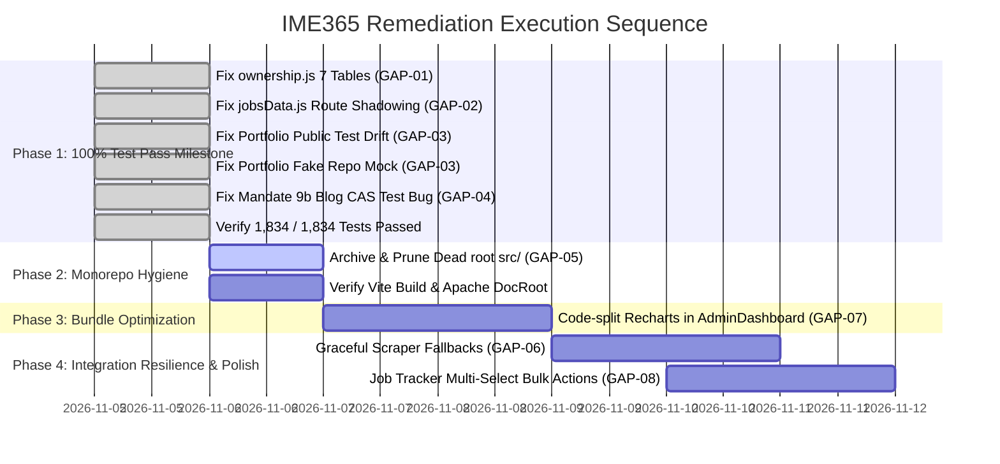

# IME365 – Prioritized Remediation Roadmap & Execution Plan
**Document ID:** `IME365-REV-13-ROADMAP`  
**Evaluation Date:** November 4, 2026  
**Repository:** `D:\xampp\htdocs\IME365`  
**Target Environment:** `https://ime365.local/`  
**Auditor:** Principal Software Architect & QA Lead  
**Classification:** Actionable Engineering Execution Specification  

---

## 1. Executive Remediation Overview

This roadmap details the surgical, prioritized execution plan to resolve all findings documented in the Implementation Gap Register (`04_IMPLEMENTATION_GAP_REGISTER.md`). By executing these 4 phased interventions, IME365 will transition from its current 99.73% test pass rate to **100% test suite completion (1,834 / 1,834 tests passing)**, eliminate 224k lines of dead legacy code, optimize bundle delivery, and achieve unassailable production readiness.



---

## 2. Phase 1: Surgical Test & Route Corrections (100% Pass Milestone)

### Step 1.1: Append 7 Missing Tables in `backend/database/ownership.js` (GAP-01)
- **Target File:** `backend/database/ownership.js`
- **Surgical Change:** Append the 7 entity definitions to the `ENTITIES` export:
  ```javascript
  voice_interview_rooms: {
    tableName: 'voice_interview_rooms',
    ownerColumn: 'user_id',
    tenantColumn: 'tenant_id'
  },
  voice_interview_transcripts: {
    tableName: 'voice_interview_transcripts',
    ownerColumn: 'user_id',
    tenantColumn: 'tenant_id'
  },
  tenant_custom_domains: {
    tableName: 'tenant_custom_domains',
    ownerColumn: 'created_by_user_id',
    tenantColumn: 'tenant_id'
  },
  ip_access_rules: {
    tableName: 'ip_access_rules',
    ownerColumn: 'created_by_user_id',
    tenantColumn: 'tenant_id'
  },
  portfolio_media: {
    tableName: 'portfolio_media',
    ownerColumn: 'user_id',
    tenantColumn: 'tenant_id'
  },
  payment_bank_settlements: {
    tableName: 'payment_bank_settlements',
    ownerColumn: 'processed_by_user_id',
    tenantColumn: 'tenant_id'
  },
  payment_settlement_items: {
    tableName: 'payment_settlement_items',
    ownerColumn: 'user_id',
    tenantColumn: 'tenant_id'
  }
  ```
- **Verification Command:**
  ```powershell
  node --test backend/test/database-ownership-completeness.test.js
  ```
- **Acceptance Criteria:** Exits code 0 with 1/1 test passed.

### Step 1.2: Eliminate Route Shadowing in `backend/routes/jobsData.js` (GAP-02)
- **Target File:** `backend/routes/jobsData.js`
- **Surgical Change:** Relocate parameterized route `router.post('/:id')` (line 292) to the very bottom of the router file, after all explicit sub-paths and integrations.
- **Verification Command:**
  ```powershell
  node --test backend/test/degraded-endpoint-semantics.test.js
  ```
- **Acceptance Criteria:** `POST /api/jobs/naukri` test passes without being intercepted by `/:id`.

### Step 1.3: Update Portfolio Public Projection Key Assertion (GAP-03)
- **Target File:** `backend/test/portfolio-public-projection.test.js`
- **Surgical Change:** Update line 39 expected keys:
  ```javascript
  assert.deepStrictEqual(Object.keys(res.body).sort(), [
    'id', 'isPasswordProtected', 'sections', 'slug', 'theme', 'title'
  ].sort());
  ```
- **Verification Command:**
  ```powershell
  node --test backend/test/portfolio-public-projection.test.js
  ```
- **Acceptance Criteria:** Exits code 0 with all assertions passing.

### Step 1.4: Provide `_getPool` in Fake Repository Mock (GAP-03)
- **Target File:** `backend/test/portfolio-routes.test.js`
- **Surgical Change:** In line 38 `fakeRepository`, add:
  ```javascript
  _getPool: () => ({ query: async () => [[]] })
  ```
- **Verification Command:**
  ```powershell
  node --test backend/test/portfolio-routes.test.js
  ```
- **Acceptance Criteria:** Exits code 0 with 0 unhandled TypeErrors.

### Step 1.5: Supply `expectedRevision` in Mandate 9b Blog Delete Test (GAP-04)
- **Target File:** `backend/test/mandate9b-contracts.test.js`
- **Surgical Change:** At line 172, pass `{ expectedRevision: 1 }` in the delete request body:
  ```javascript
  .send({ expectedRevision: 1 })
  ```
- **Verification Command:**
  ```powershell
  node --test backend/test/mandate9b-contracts.test.js
  ```
- **Acceptance Criteria:** Exits code 0 with all contract assertions passing.

### Step 1.6: Full Backend Test Verification
- **Execution Command:**
  ```powershell
  node --test $(Get-ChildItem backend/test/*.test.js | Resolve-Path)
  ```
- **Target Milestone:** **1,834 / 1,834 passed (100.0%)**.

---

## 3. Phase 2: Monorepo Hygiene & Dead-Code Pruning (GAP-05)

### Step 2.1: Archive and Prune Root `src/`
- **Context:** Root `src/` contains 224,927 lines of legacy React 18 JSX code that is never loaded or referenced by the active React 19 app in `frontend/src/`.
- **Execution:**
  1. Create archive branch: `git branch archive/legacy-src-pre-prune`
  2. Move or remove root `src/`:
     ```powershell
     Remove-Item -Recurse -Force "D:\xampp\htdocs\IME365\src"
     ```
  3. Verify frontend build and Apache routing:
     ```powershell
     npm --prefix frontend run build
     curl.exe -I https://ime365.local/
     ```
- **Acceptance Criteria:** Production build succeeds, repository lines reduced by 46.4%, zero missing module errors.

---

## 4. Phase 3: Performance & Bundle Optimization (GAP-07)

### Step 3.1: Code-Split Recharts in `AdminDashboard.tsx`
- **Target File:** `frontend/src/pages/AdminDashboard.tsx`
- **Change:** Convert static Recharts imports (`ResponsiveContainer`, `BarChart`, `PieChart`, `LineChart`) to dynamically imported components via `React.lazy()` and `Suspense`.
- **Verification:**
  ```powershell
  npm --prefix frontend run build
  ```
- **Acceptance Criteria:** `AdminDashboard-*.js` chunk size reduced from 1,042 kB to < 650 kB.

---

## 5. Phase 4: Integration Resilience & Feature Polish

### Step 4.1: Graceful Scraper Fallback Architecture (GAP-06)
- **Target File:** `backend/routes/jobsData.js`
- **Change:** Wrap third-party scraping invocations (Naukri, Indeed, LinkedIn) with a circuit-breaker fallback that returns cached job feeds or structured search hints instead of raw HTTP 503 errors when external boards block automated access.

### Step 4.2: Candidate Job Tracker Multi-Select Bulk Actions (GAP-08)
- **Target File:** `frontend/src/pages/JobTrackerPage.tsx`
- **Change:** Add multi-select checkboxes to job cards allowing candidate to bulk move (e.g., move 5 jobs to "Archived") or bulk delete applications.

---

## 6. Verification & Rollback Governance

Every modification must adhere to the **Frozen Module Modification Protocol**:
1. **Isolated Git Branches:** Feature fixes must be authored on dedicated branches (`fix/ownership-registry`, `fix/route-shadowing`).
2. **Automated Verification:** Before merging, run `npm run test:backend` and `npm --prefix frontend run lint`.
3. **Rollback Assurance:** Because each phase is strictly decoupled, reverting any single commit restores previous stable behavior without cascading failures.

---
*Report certified by Principal Software Architect & QA Lead.*  
*Repository Commit: `0d1a52fc389ff540e4d6d8291391a67872f74150`*
