# AI Multi-Provider Engine — Consumer Map

**Date:** 2026-10-24 · **Base:** `5bd2570` · **Method:** repository-wide grep (`backend/`, `frontend/`, `scripts/`, `src/`) + live probes.
Every node below cites the file that implements it. Where a consumer does not exist, it is listed as **absent** rather than guessed.

> **2026-10-25 UPDATE:** sections 1–4 below are the preserved 2026-10-24 baseline (`5bd2570`). The **final-state** consumer map after remediation of all 29 findings (branch tip `e848552`) is in **§5** (Mermaid + route deltas), the settings→behaviour matrix with gap→wired SHAs is in **§6**, and the A.5/A.9/A.10 **design preconditions** are in **§7** (cross-ref `engine-findings.md` §10). **2026-10-26 UPDATE: the reviewer decided — A.9/A.10 rejected as a final state and CLOSED with code (`e606c72`, `ac93772`); §7 now carries the closure notes and the new `exploration` wire field.** Where §1–§4 and §5–§7 differ, §5–§7 describe the current tree.

---

## 1. Mermaid — request origin → response

```mermaid
flowchart TD
    %% ───────────── ORIGINS ─────────────
    SDK["OpenAI / Anthropic SDK<br/>Cursor · Cline · Roo · Claude Code"]
    BROWSER["Browser app (candidate)<br/>resume · interview · cover letter"]
    ADMIN["Admin console<br/>/admin?tab=ai-settings"]
    TENANT["Enterprise tenant client<br/>/api/enterprise/*"]
    CRON["Cron: setInterval 6h<br/>freellmapi/index.js:158"]

    %% ───────────── AUTH GATES ─────────────
    V1AUTH{"resolveV1Principal<br/>index.js:2702<br/>platform key OR Firebase token<br/>anonymous only if non-prod & NO keys"}
    APIAUTH{"requireAuth / optionalAuth<br/>index.js:464-480"}
    ADMINAUTH{"requireSuperAdmin<br/>+ path policy<br/>security/auth.js:236<br/>security/policy.js:54-97"}
    ENTAUTH{"createEnterpriseAuthMiddleware<br/>index.js:462<br/>+ tenant RBAC + ai.use"}
    GOV{"aiGovernanceMiddleware<br/>security/aiGovernance.js:278<br/>only on /api/ai*"}
    QUOTA{"enforceDailyAiQuota<br/>security/abuse.js:301<br/>only on /api/ai*"}
    BURST{"aiAccountLimiter<br/>security/abuse.js:103<br/>12/min"}

    %% ───────────── SERVICES ─────────────
    V1SVC["/v1 handler<br/>index.js:2786 / 2974 / 3034"]
    PRODSVC["routes/ai.js<br/>generate-content :1225<br/>parse-resume :1256<br/>generate-interview :784<br/>live-interview :986"]
    COVERSVC["/api/generate-ai-cover-letter<br/>index.js:5075"]
    ENTSVC["routes/enterprise.js<br/>ai/generate-content :743<br/>ai/generate-interview :794"]
    ADMINSVC["admin AI routes<br/>index.js:3165-3978"]
    CFGLOAD["loadFreeLlmPlatformConfig<br/>freellmConfig.js:56<br/>10 s cache"]

    %% ───────────── CONFIG READS ─────────────
    SETTINGS[("system_settings<br/>public_config.ai<br/>ai_providers<br/>system_settings.ai")]

    %% ───────────── ENGINE ─────────────
    AIRT["aiRuntime.generateWithProviders<br/>aiRuntime.js:1744"]
    FREECALL["freellm.completeChat<br/>aiRuntime.js:1775"]
    NEWROUTE["aiRouting.route<br/>aiRuntime.js:1870<br/>REACHED ONLY for non-502/non-503 errors"]
    BUILD["FreeLlmRouter.buildCandidateList<br/>router.js:257"]
    TENANTTIER{"tenantContext.customProviderKeys<br/>present? router.js:258"}
    BYOKTIER["TIER 2 'dedicated BYOK'<br/>router.js:262-297<br/>isDedicatedByok=true"]
    MESH["TIER 1 platform mesh<br/>router.js:300-396"]
    POLICY["applySelectionPolicy<br/>router.js:191<br/>mode? → rankCandidates"]
    MODE{"selectionMode<br/>public_config.ai"}
    AUTO["auto / balanced<br/>rel 40 · speed 20 · fit 10"]
    SPEED["speed<br/>rel 20 · speed 60 · fit 0"]
    QUAL["quality<br/>rel 30 · speed 0 · fit 30"]
    MANUAL["manual<br/>pin to primary<br/>router.js:203,215,227"]

    %% ───────────── GATES AT ROUTING TIME ─────────────
    GATE{"enabled? key?<br/>cooldown? reachable?<br/>router.js:336,349,366<br/>selectionPolicy.js:8-20"}
    DISC["modelDiscovery.getOrDiscover<br/>1 h cache · /models per provider"]
    CANDS["candidate list (≤12)<br/>router.js:232"]

    %% ───────────── EXECUTION ─────────────
    KEYS{"multi-key pool<br/>router.js:598"}
    RETRY{"retry same provider?<br/>legacy: NO<br/>aiRouting: 1 (2 if latency-critical)"}
    PROVIDER[("External provider<br/>openai-compat / google / horde")]
    FAILover{"next candidate?<br/>router.js:683-697"}
    ALLFAIL["502 ALL_PROVIDERS_FAILED<br/>router.js:700-706"]
    NOELIG["503 AI_PROVIDER_UNAVAILABLE<br/>router.js:562-567"]

    %% ───────────── OBSERVABILITY / STORES ─────────────
    CACHE[("promptCache<br/>500 entries · 1 h · no tenant on /v1<br/>cache.js:14")]
    COOLDOWN[("CooldownManager<br/>60 s → 300 s · provider:model<br/>global, not tenant-scoped")]
    METRICS[("SQLite freellm_metrics.db<br/>provider_metrics · request_log<br/>no tenant column")]
    HEALTH[("aiRouting HealthStore<br/>tenantId|provider|model<br/>healthStore.js:44")]
    TELEM[("aiRouting RoutingTelemetry<br/>tenant-scoped ring<br/>NOT exposed by any route")]
    RESP["Response<br/>_freellmapi.provider · model · latency<br/>routing_decision (only if mode set)<br/>fallbacks[]"]

    %% ───────────── EDGES ─────────────
    SDK --> V1AUTH --> V1SVC
    BROWSER --> APIAUTH
    APIAUTH --> GOV --> QUOTA --> BURST --> PRODSVC
    APIAUTH --> COVERSVC
    TENANT --> ENTAUTH --> ENTSVC
    ADMIN --> ADMINAUTH --> ADMINSVC
    CRON --> COOLDOWN
    CRON -.->|"calls missing cleanExpired()"| CACHE

    V1SVC --> CFGLOAD
    PRODSVC --> AIRT
    COVERSVC --> AIRT
    ENTSVC --> AIRT
    ADMINSVC --> SETTINGS
    CFGLOAD --> SETTINGS
    SETTINGS --> CFGLOAD

    AIRT --> FREECALL
    AIRT -.->|"error not ALL_PROVIDERS_FAILED and not 503"| NEWROUTE
    FREECALL --> BUILD
    NEWROUTE --> POLICY
    BUILD --> TENANTTIER
    TENANTTIER -->|yes| BYOKTIER
    TENANTTIER -->|no| MESH
    BYOKTIER --> POLICY
    MESH --> POLICY
    POLICY --> MODE
    MODE --> AUTO & SPEED & QUAL & MANUAL
    AUTO --> CANDS
    SPEED --> CANDS
    QUAL --> CANDS
    MANUAL --> CANDS
    POLICY --> DISC --> CANDS
    CANDS --> GATE
    GATE -->|reject| FAILover
    GATE -->|eligible| KEYS --> RETRY --> PROVIDER
    PROVIDER -->|2xx| RESP
    PROVIDER -->|"4xx/5xx/timeout"| FAILover
    FAILover -->|yes| KEYS
    FAILover -->|no| ALLFAIL
    GATE -->|"no candidates at all"| NOELIG

    PROVIDER -->|success| COOLDOWN
    PROVIDER -->|failure| COOLDOWN
    PROVIDER -->|success| METRICS
    PROVIDER -->|failure| METRICS
    PROVIDER -->|"scoped=tenant ⇒ SKIPPED"| METRICS
    AIRT -->|replays attempts| HEALTH
    AIRT -->|replays attempts| TELEM
    FREECALL --> CACHE
    CACHE --> RESP

    classDef p0 fill:#fee,stroke:#c00,stroke-width:2px
    classDef p1 fill:#fff4e5,stroke:#e07b00
    class V1AUTH,V1SVC p0
    class BYOKTIER,MANUAL,CACHE p1
```

### Reading the chart

- **Everything left of `aiRuntime` is admission control; everything right of it is the engine.** The `/v1` path (P0 red) has no admission control at all.
- **`aiRouting.route` is a dotted edge.** It is only reached when `freellm.completeChat` throws a code that is neither `ALL_PROVIDERS_FAILED` nor HTTP 503 (`aiRuntime.js:1847-1870`). Normal product traffic never touches the new selector.
- **Cache and cooldown are shared globals.** For `/v1` they carry no tenant/principal. For enterprise calls `tenantContext` isolates the cache key but suppresses metrics and cooldowns entirely (`BYOKTIER`).
- **`CRON` has a dotted edge to cache** because `promptCache.cleanExpired` does not exist (`cache.js` has no such method); that call throws and is swallowed (`freellmapi/index.js:161-168`).

---

## 2. Tabular view

`consumer | entry | auth | routing mode | settings read | failure handling`

| Consumer | Entry (file:line) | Auth | Routing mode | Settings read | Failure handling |
|---|---|---|---|---|---|
| OpenAI-compatible SDK | `POST /v1/chat/completions` (`index.js:2786`) | `optionalAuth` + `resolveV1Principal` (`:2702`) — platform key or Firebase token; anonymous only non-prod & no keys | `selectionMode` if set, else legacy `_computeDynamicRankScore` | `ai_providers` (keys/pools/enabled/model/baseUrl), `public_config.ai` (provider, selectionMode, fallback, temperature, maxTokens) | per-candidate failover; 502 `ALL_PROVIDERS_FAILED`; 503 no candidate; stream committed after first token |
| Anthropic SDK / Claude Code | `POST /v1/messages` (`index.js:2974`) | same | same | same | same, via `handleAnthropicMessages` |
| Agent search | `POST /v1/search` (`index.js:3034`) | same | search chain (not chat) | search provider keys from env/DB | 502 `ALL_SEARCH_PROVIDERS_FAILED` |
| Model catalog | `GET /v1/models` (`index.js:3088`) | **none** | n/a (static catalog) | env only | 500 on engine error |
| Engine status | `GET /v1/status`, `/api/freellmapi/status` (`index.js:3117`) | **none** | n/a | live engine state incl. cooldowns + SQLite path | 200 always |
| Durable metrics | `GET /api/freellmapi/metrics` (`index.js:3122`) | `requireSuperAdmin` | n/a | none | 503 on store error |
| Product content ops | `/api/ai/generate-content` (`routes/ai.js:1225`), legacy `/api/generate-content` | `requireAuth` + governance + burst + daily quota (`index.js:556-569`) | freellm legacy / mode | full config + tenant policy | grounded fallback or explicit `AI_UNAVAILABLE`; never invented content (`aiRuntime.js:2084-2106`) |
| Resume parsing | `/api/ai/parse-resume` (`routes/ai.js:1256`) | same | same | same | provider error → controlled error |
| Grammar | `/api/ai/check-grammar` (`routes/ai.js:1180`) | same | same | same | same |
| Interview questions | `/api/ai/generate-interview` (`routes/ai.js:784`), `/api/generate-interview` | same | same | same | 502 `INVALID_AI_OUTPUT` / provider error |
| Live interview | `/api/live-interview/*` (`routes/ai.js:986-1091`) | `requireAuth`; POST also governance + quota (`index.js:565-568`) | same | same | per-turn abort signal; session state errors |
| Cover letter | `/api/generate-ai-cover-letter` (`index.js:5075`) | `requireAuth` + quota list (`index.js:557-560`) | same | same | output validation → 503 `AI_OUTPUT_REJECTED`, no template substitution |
| Enterprise content | `/api/enterprise/ai/generate-content` (`routes/enterprise.js:743`) | enterprise auth + `ai.use` + tenant quota | freellm **BYOK tier** (platform keys) | tenant `aiPolicy` (allowedProviders/models, primaryModel), platform config | 503 metering unavailable; 403 tenant policy; 502 generation |
| Enterprise interview | `/api/enterprise/ai/generate-interview` (`routes/enterprise.js:794`) | same | same | same | same |
| Admin settings read | `GET /api/admin/ai-settings` (`index.js:3165`) | `requireSuperAdmin` + `system.config.read` | n/a | all settings + catalog + cooldowns | 503 on repository error |
| Admin settings write (BYOK) | `POST /api/admin/ai-settings` (`index.js:3840`) | `requireSuperAdmin` **only** (no recent auth) | n/a | read-modify-write with revision check | 409 `AI_SETTINGS_CONFLICT`; 400 validation; cache cleared on success |
| Admin key probe | `POST /api/admin/ai/test-provider` (`index.js:3861`), `/api/admin/ai/fetch-models` (`:3874`) | `requireSuperAdmin` (+ limiter) | n/a | provider config or supplied key | provider error surfaced |
| Admin quota | `GET /api/admin/ai/quota-stats` (`index.js:3888`), `POST /api/admin/ai/quota-limits` (`:3935`), `POST /api/admin/ai/reset-quota` (`:3958`) | path policy `ai.usage.read` / `ai.entitlements.manage` (+ recent auth on mutations) | n/a | MariaDB `ai_usage` + `ai_quota` | 503 `AI_QUOTA_STORAGE_UNAVAILABLE` |
| Tenant AI policy / BYOK | `PATCH /api/admin/platform/tenants/:id/ai-policy` (`adminPlatformOperations.js:393`), `POST …/ai-keys/test` (`:451`) | `system.config.write` + recent auth + `requireSuperAdmin` | n/a | tenant config + encrypted credentials | 400/404/409 via `sendTenantError`; **no audit event** |
| Cron (engine) | `startAutonomousMaintenance` 6 h (`freellmapi/index.js:158-174`, started `index.js:5294`) | none | n/a | none | cooldown purge OK; cache purge throws (swallowed) |
| Cron (other) | live-session prune `index.js:5314`, CMS scheduler `:5337`, subscription reconciler `:5379`, outbox `:5423`, enterprise outbox `:5494`, tenant GC `:5531` | n/a | n/a | n/a | not AI routing (listed to prove they do not call the engine) |
| Webhook | **no AI webhook exists** | — | — | — | — |
| Batch / backfill | **no AI batch job exists** | — | — | — | — |
| Partner integration | **none documented** beyond OpenAI/Anthropic wire compatibility | — | — | — | — |
| SDK / embedded agent | `runClaudeCodeTask` exported (`freellmapi/index.js:225`, `agent/claudeCodeAgent.js:338`) but **no caller in the repo** | — | — | — | dead export |

---

## 3. Settings dependencies per consumer (what a settings change actually moves)

| Setting | Read by | Effect | Latency to take effect |
|---|---|---|---|
| `ai_providers[*].apiKey/apiKeys` | `freellmConfig.buildFreeLlmPlatformConfig:89-94` | key pools, credential presence | 10 s cached; **immediate** on admin save (cache cleared) |
| `ai_providers[*].enabled/disabled` | `freellmConfig.js:98-99` | candidate inclusion | 10 s / immediate |
| `ai_providers[*].model` | `freellmConfig.js:96` | legacy model target; **manual-mode pin** (F-02) | 10 s / immediate |
| `ai_providers[*].baseUrl` | `freellmConfig.js:97` | custom OpenAI-compatible endpoint | 10 s / immediate |
| `public_config.ai.provider` | `freellmConfig.js:110-112` | primary + provider order | 10 s / immediate |
| `public_config.ai.selectionMode` | `freellmConfig.js:116` | switches policy B on, enables `routing_decision` | 10 s / immediate |
| `public_config.ai.enableFallback` | `freellmConfig.js:117` | pins to primary when `false` | 10 s / immediate |
| `public_config.ai.temperature/maxTokens` | `freellmConfig.js:118-119` | generation parameters (clamped again in `aiRuntime.js:1663-1664`) | 10 s / immediate |
| `public_config.ai.enable
` (legacy 6) | `aiRuntime.js:1652` | *second* enabled flag for the product engine | 15 s / immediate |
| `public_config.ai.provider` (same) | `aiRuntime.js:1660` | product-engine primary | 15 s / immediate |
| tenant `aiPolicy.allowedProviders` | `tenantAi.js:25-34` | deny-by-default provider allowlist (empty ⇒ 403) | next request |
| tenant `aiPolicy.allowedModels/restrictedModels` | `tenantAi.js:43-50` | model gates | next request |
| tenant `aiPolicy.primaryModel` | `tenantAi.js:65-71` | primary selection / +50 score in policy C | next request |
| tenant `quotaPolicy.aiRequestsPerMinute/Day` | `routes/ai.js:212-225`, `routes/enterprise.js:760-761` | quota counters | next request |
| `featureFlag ai_settings_v2_enabled` | `aiAdmin.js:348-353` (display only) | **no engine effect** | n/a |
| `FREELMAPI_API_KEYS` (env) | `freellmConfig.platformApiKeys:128-130` | `/v1` admission | process restart |
| `OPENAI/GROQ/…_API_KEY`, `_BASE_URL`, `_MODEL` (env) | `freellmConfig.js:89,97`; `aiRuntime.js:1644-1647` | highest-precedence credentials | process restart |

---

## 4. Absent consumers (explicitly stated, not guessed)

- **No scheduled provider health check.** `probeProviderConnection` is only called from admin actions (`freellmapi/index.js:76-78`, `routes/adminPlatformOperations.js:470-482`).
- **No AI webhook / callbacks.**
- **No batch or backfill job** that calls the engine.
- **No cron that resets quotas** — quota keys are date-scoped (`security/abuse.js:291-293`), so no reset is needed.
- **No cron that compacts or prunes `ai_usage`** (grep for `ai_usage` + `DELETE` outside admin reset: none).
- **No endpoint that exposes the aiRouting health/telemetry state** — `RoutingTelemetry` and `HealthStore.tenantSnapshot` have no route.

---

## 5. Post-fix consumer map (2026-10-25)

**Basis:** branch tip `e848552` (docs land `eb0512f`+). Sections 1–4 above are the preserved 2026-10-24 baseline (`5bd2570`); this section restates the map at the final state — 26 findings FIXED, F-21/F-22-sub DEFERRED (PH4-ENGINE-021/022), F-26 ACCEPTED (PH4-ENGINE-026). Line numbers cite the current tree.

### 5.1 Mermaid — final state

```mermaid
flowchart TD
    %% ───────────── ORIGINS ─────────────
    SDK["OpenAI / Anthropic SDK<br/>Cursor · Cline · Roo · Claude Code"]
    BROWSER["Browser app<br/>resume · interview · cover letter"]
    ADMIN["Admin console<br/>/admin?tab=ai-settings"]
    TENANT["Enterprise tenant client<br/>/api/enterprise/*"]
    CRON["Cron: setInterval 6h<br/>freellmapi/index.js"]

    %% ───────────── AUTH GATES ─────────────
    V1AUTH{"resolveV1Principal<br/>platform key OR Firebase token<br/>anonymous only if non-prod & NO keys"}
    V1ADM{"F-01 admission (875d4c7)<br/>user principal ⇒ limiter → governance →<br/>durable daily quota, charged pre-invocation<br/>platform key ⇒ burst limiter<br/>catalog routes never quota-charged"}
    APIAUTH{"requireAuth / optionalAuth"}
    ADMINAUTH{"requireSuperAdmin<br/>+ path policy"}
    ENTAUTH{"enterprise auth<br/>+ tenant RBAC + ai.use<br/>+ resolveTenantQuota (F-27 a3eb324)<br/>explicit 0 ⇒ 429 TENANT_QUOTA_BLOCKED<br/>guard missing ⇒ 503 fail-closed"}
    GOV{"aiGovernanceMiddleware<br/>on /api/ai* AND /v1 user principals (F-01)"}
    QUOTA{"enforceDailyAiQuota<br/>durable ai_usage ledger (F-01/F-18 4e5c8b0)<br/>tokens/cost persisted, null-when-unknown"}
    BURST{"aiAccountLimiter 12/min"}

    %% ───────────── SERVICES ─────────────
    V1SVC["/v1 handlers<br/>chat/completions · messages · search"]
    PRODSVC["routes/ai.js product ops"]
    ENTSVC["routes/enterprise.js AI ops"]
    ADMINSVC["admin AI routes<br/>GET: configuredProviders vs enabledProviders<br/>split (F-16 6222aab); masked keys; envelopes (F-19 d98739e)<br/>POST: F-04 save validation (manual pin needs explicit model)<br/>F-15 no fabricated toggles (31837fa)<br/>F-29 one force mechanism + forced:true audit (a0c343d)"]
    RESET["POST /api/admin/ai/reset-state<br/>index.js:4135 (F-13 8f47713)<br/>super-admin · per-store results"]
    TELEMROUTE["GET /api/admin/ai/routing-telemetry<br/>index.js:4186 (F-22 22349d2)<br/>super-admin · redacted ring + health snapshot"]

    %% ───────────── ENGINE SELECTION (F-05) ─────────────
    ENGINESEL{"AI_ENGINE (F-05 875d4c7)<br/>aiRuntime.js:1751-1777"}
    FREECALL["freellm.completeChat (default)"]
    SHADOW["shadow: aiRouting.route runs FIRST<br/>+ bounded 100-entry secret-free divergence log<br/>then freellm serves"]
    AIRTFULL["aiRouting: end-to-end"]

    %% ───────────── ROUTING ─────────────
    BUILD["FreeLlmRouter.buildCandidateList<br/>router.js:257"]
    TENANTTIER{"tenant BYOK keys present?"}
    BYOKTIER["TIER 2 dedicated BYOK<br/>encrypted tenant store now READ<br/>by the inference path (F-08 875d4c7)"]
    MESH["TIER 1 platform mesh<br/>platform-key tenant traffic records<br/>metrics + cooldowns (F-09 875d4c7)"]
    POLICY["applySelectionPolicy → rankCandidates<br/>windowed recency-weighted p50, half-life 10 min,<br/>n≥3 gate, fresh-failure breaker (F-07 875d4c7)<br/>curated tier bonus ×40, primary bonus +5 (F-06 875d4c7)"]
    MODE{"selectionMode"}
    GATE{"enabled? key? cooldown? reachable?<br/>SINGLE enabled source = ai_providers[p].enabled<br/>gates BOTH engines (F-23 3a8475d)<br/>legacy enable&lt;P&gt; = AND-ed compat input only"}
    DISC["modelDiscovery 1h cache"]
    CANDS["candidate list (≤12)"]

    %% ───────────── EXECUTION ─────────────
    KEYS{"multi-key pool"}
    PROVIDER[("External provider")]
    FAILover{"next candidate?"}
    MANUALDOWN{"manual pin down? (F-03 875d4c7)"}
    M503["503 provider_unavailable<br/>+ Retry-After: 60 (clamped, F-12 6d595bf)<br/>default: honest refusal"]
    MFALL["manualAllowFallback:true ⇒<br/>200 from secondary, routing_decision<br/>.fallbackFrom:'manual' (disclosed)"]
    ALLFAIL["502 ALL_PROVIDERS_FAILED (auto paths)<br/>fallbacks[] populated, provider internals<br/>sanitized to 'Upstream provider error' (F-20 a8330f8)"]
    LASTRES["all cooling ⇒ last-resort release of<br/>least-bad cooldown (F-14 a860d0b)"]

    %% ───────────── STORES ─────────────
    CACHE[("promptCache<br/>identity carries principal/tenant on /v1<br/>(F-02 875d4c7); cleanExpired() implemented (F-11 6dc5976)")]
    COOLDOWN[("CooldownManager<br/>still PLATFORM-scoped ⇒ PH4-ENGINE-021<br/>(F-21 deferred, reviewer-approved)")]
    METRICS[("SQLite freellm_metrics.db<br/>still no tenant column ⇒ PH4-ENGINE-021;<br/>no per-row decisionId ⇒ PH4-ENGINE-022")]
    HEALTH[("aiRouting HealthStore tenant-scoped")]
    TELEM[("aiRouting RoutingTelemetry<br/>NOW EXPOSED via TELEMROUTE (F-22)")]
    RESP["Response<br/>_freellmapi.provider · model · latency<br/>routing_decision + observedLatencyMs + observationCount<br/>fallbacks[] sanitized · cached principal-honest<br/>generation defaults one source 0.7/2048 (F-28 b1cd2cc)"]

    %% ───────────── EDGES ─────────────
    SDK --> V1AUTH --> V1ADM --> V1SVC
    BROWSER --> APIAUTH --> GOV --> QUOTA --> BURST --> PRODSVC
    TENANT --> ENTAUTH --> ENTSVC
    ADMIN --> ADMINAUTH --> ADMINSVC
    ADMINAUTH --> RESET
    ADMINAUTH --> TELEMROUTE
    CRON --> COOLDOWN
    CRON --> CACHE

    V1SVC --> ENGINESEL
    PRODSVC --> ENGINESEL
    ENTSVC --> ENGINESEL
    ENGINESEL -->|freellm| FREECALL
    ENGINESEL -->|shadow| SHADOW
    ENGINESEL -->|aiRouting| AIRTFULL
    FREECALL --> BUILD
    SHADOW --> BUILD
    AIRTFULL --> POLICY
    BUILD --> TENANTTIER
    TENANTTIER -->|yes| BYOKTIER
    TENANTTIER -->|no| MESH
    BYOKTIER --> POLICY
    MESH --> POLICY
    POLICY --> MODE --> GATE
    POLICY --> DISC --> CANDS --> GATE
    GATE -->|reject| FAILover
    GATE -->|eligible| KEYS --> PROVIDER
    PROVIDER -->|2xx| RESP
    PROVIDER -->|failure| FAILover
    FAILover -->|yes| KEYS
    FAILover -->|"no — manual pin"| MANUALDOWN
    MANUALDOWN -->|default| M503
    MANUALDOWN -->|opt-in| MFALL
    FAILover -->|"no — auto paths"| ALLFAIL
    FAILover -->|"all cooling"| LASTRES --> KEYS

    PROVIDER --> COOLDOWN
    PROVIDER --> METRICS
    BYOKTIER -.->|"dedicated BYOK: platform metrics skipped BY DESIGN"| METRICS
    AIRTFULL --> HEALTH
    AIRTFULL --> TELEM
    TELEMROUTE --> TELEM
    TELEMROUTE --> HEALTH
    RESET --> CACHE
    RESET --> COOLDOWN
    RESET --> METRICS
    FREECALL --> CACHE
    CACHE --> RESP

    classDef fixed fill:#e6ffe6,stroke:#0a0
    classDef still fill:#fff4e5,stroke:#e07b00
    class V1ADM,GOV,QUOTA,CACHE,ENGINESEL,POLICY,GATE,TELEMROUTE,RESET fixed
    class COOLDOWN,METRICS,BYOKTIER still
```

### 5.2 Reading the final-state chart

- **The P0 red is gone.** `/v1` user principals now run the exact `/api/ai*` admission chain — limiter → governance → durable daily quota charged **pre-invocation** (F-01, `875d4c7`; live-proven A.6: `ai_usage` +3, and the A.9/A.10 first-run 429s are the ledger blocking the probes themselves). Platform keys run the burst limiter; catalog routes are never quota-charged.
- **`aiRouting.route` is no longer a dotted accidental door.** `AI_ENGINE=freellm|shadow|aiRouting` (F-05) is an explicit deploy-time choice; shadow runs the new selector first with a bounded 100-entry secret-free divergence log.
- **Cache and cooldown are no longer the same story.** Cache identity carries the principal on `/v1` (F-02, A.2 `cached:false`). Cooldowns/metrics remain **platform-scoped** — that is the deferred remainder PH4-ENGINE-021 (F-21), orange in the chart, not fixed.
- **The BYOK sanctuary is closed:** the encrypted tenant store is read by the inference path (F-08), and platform-key tenant traffic records metrics + cooldowns (F-09). Dedicated-BYOK traffic still skips *platform* metrics by design (the tenant's own keys are not platform capacity).
- **`CRON → CACHE` is a solid edge:** `cleanExpired()` exists (F-11).
- **Telemetry is exposed** via `GET /api/admin/ai/routing-telemetry` (F-22, super-admin, redacted) and operator state is resettable via `POST /api/admin/ai/reset-state` (F-13) — §4's "no endpoint exposes aiRouting health/telemetry" is superseded.
- **The dead `ai_settings_v2_enabled` switch and its UI control were removed** (F-24) — the §3 matrix row for it now reads "removed; no engine effect ever existed".

### 5.3 Route-table deltas (rows that changed vs §2)

| Consumer / route | Was (2026-10-24) | Now (final state) | Wired at |
|---|---|---|---|
| `POST /v1/chat/completions`, `/v1/messages` (user principal) | no admission control; unmetered | limiter → governance → durable daily quota charged pre-invocation; `ai_usage` rows with scope/email/limit | F-01/F-18 · `875d4c7`, `4e5c8b0` |
| `/v1` failure bodies | provider internals forwarded (`"server error from alpha (HTTP 500)"`) | sanitized `"Upstream provider error"`; `fallbacks[]` disclosure kept | F-20 · `a8330f8` |
| `/v1` sampling defaults (unconfigured) | engines disagreed (0.3/4096 vs admin defaults) | one frozen source: 0.7 / 2048 both engines (disclosed contract change) | F-28 · `b1cd2cc` |
| `GET /v1/status` | public 200 with internals (cooldown list, SQLite path) | anonymous → 401 `missing_api_key`; super-admin → reduced payload | F-10 · `52e1a35` |
| manual pin, provider down | 502 `ALL_PROVIDERS_FAILED`, secondary idle | 503 `provider_unavailable` + `Retry-After: 60`; opt-in `manualAllowFallback` → 200 with `fallbackFrom:"manual"` | F-03 · `875d4c7` |
| admin save `manual` + model-less provider | saved, then phantom `"auto"` pin at routing | 400 `AI_SETTINGS_VALIDATION_ERROR` at save; already-saved empty pin = "provider default" | F-04 · `875d4c7` |
| admin partial save | fabricated `enable
=true` | omitted toggles stay null | F-15 · `31837fa` |
| admin forced save | two force spellings, thin audit | one mechanism; audit rows carry `forced:true` + sanitized `forceReason`; single CAS conflict code | F-29 · `a0c343d` |
| admin GET payload | "configured" conflated with enabled | `configuredProviders` vs `enabledProviders` split (C3: dual map is a designed contract) | F-16 · `6222aab` |
| secrets at rest | clear text in `ai_providers` | AES-256-GCM envelopes; fail-closed without `ENTERPRISE_ENCRYPTION_KEY(S)` | F-19 · `d98739e` |
| `POST /api/admin/ai/reset-state` | **absent** | super-admin operator reset with per-store results | F-13 · `8f47713` |
| `GET /api/admin/ai/routing-telemetry` | **absent** (telemetry existed, unexposed) | super-admin redacted ring + health snapshot | F-22 · `22349d2` |
| tenant AI usage audit | structurally empty `aiRouting: {}` | executed provider/model/tier from the live engine | F-17 · `547dabc` |
| tenant quota resolution | per-site coercion (`Number([])===0`), skippable guard | one `resolveTenantQuota()`; explicit 0 blocks (429); missing guard fail-closed (503) | F-27 · `a3eb324` |
| all-cooling deployments | hard 503 up to 300 s | last-resort release of least-bad cooldown | F-14 · `a860d0b` |
| cron cache purge | threw (no `cleanExpired`), swallowed | implemented | F-11 · `6dc5976` |
| provider enable flag | two engines, two truths | `ai_providers[p].enabled/disabled` gates **both**; legacy `enable
` AND-ed compat input | F-23 · `3a8475d` |
| `featureFlag ai_settings_v2_enabled` | display-only dead switch | **removed** (flag + UI control) | F-24 · `2f8f698` |

---

## 6. Settings → behaviour matrix, gap → wired SHA (supersedes §3 where they differ)

| Setting | Gap at baseline (§3) | Final behaviour | Wired at |
|---|---|---|---|
| `public_config.ai.selectionMode=speed` | ranked on a single stale last sample | windowed recency-weighted p50, half-life 10 min, **n≥3 gate**, fresh-failure breaker; mature fast window flips selection off the primary (A.9r3) | F-07 · `875d4c7` |
| `public_config.ai.selectionMode=quality` | no quality signal existed; mode name dishonest | curated static tier table decides (premium 1 / standard 0.55 / economy 0.2 ×40); uncurated models honestly `qualityEvidence:"unknown"`, no bonus (A.10r1/r2) | F-06 · `875d4c7` |
| `public_config.ai.selectionMode=manual` (+`provider`) | empty pin became phantom `"auto"`; pinned-down = opaque 502 | save-time validation (400 with actionable message); empty saved pin = provider default; pinned-down = 503 + Retry-After; opt-in `manualAllowFallback` discloses `fallbackFrom:"manual"` | F-03/F-04 · `875d4c7` |
| `public_config.ai.enable
` (legacy 6) | second independent enabled flag; partial saves fabricated `true` | AND-ed compatibility input only — never an independent gate; omitted toggles stay null | F-23 · `3a8475d`; F-15 · `31837fa` |
| `ai_providers[*].enabled/disabled` | gated only the legacy engine | single enabled source of truth, gates **both** engines (A.4) | F-23 · `3a8475d` |
| `ai_providers[*].apiKey(s)` | clear text at rest | AES-256-GCM envelopes, fail-closed without the key; masked in APIs; LIKE-scan 0 | F-19 · `d98739e` |
| `public_config.ai.temperature/maxTokens` | engines disagreed when unconfigured | one frozen defaults module at all 5 fallback sites (0.7/2048) | F-28 · `b1cd2cc` |
| `featureFlag ai_settings_v2_enabled` | dead switch implying rollback | removed | F-24 · `2f8f698` |
| `AI_ENGINE` (env, new) | new selector reachable only via accidental error class | explicit `freellm\|shadow\|aiRouting` choice; shadow keeps bounded secret-free divergence log | F-05 · `875d4c7` |
| `ENTERPRISE_ENCRYPTION_KEY(S)` (env) | n/a (no envelopes) | required for at-rest secrets; fail-closed; rotation = ops runbook item (rating §8.5 Q4) | F-19 · `d98739e` |
| `FREELMAPI_API_KEYS` (env) | platform-key `/v1` traffic ungoverned | platform-key principals: burst limiter, no daily-quota charge; user principals: full chain | F-01 · `875d4c7` |
| tenant `quotaPolicy.*` | per-site coercion bugs; guard skippable | single resolver; explicit 0 = blocked (429 `TENANT_QUOTA_BLOCKED`); missing guard = 503 fail-closed | F-27 · `a3eb324` |
| tenant BYOK keys | write-only (never consumed) | read by the inference path; dedicated-BYOK tier uses the tenant key | F-08 · `875d4c7` |
| admin save `expectedRevision` | conflict handling inconsistent | 409 `REVISION_CONFLICT`; forced saves attributable (`forced:true` + reason) | F-29 · `a0c343d` |
| propagation latency | 10–15 s process-local | **unchanged by design** — bounded ≤15 s convergence, single-instance assumption documented | F-26 ACCEPTED · PH4-ENGINE-026 |

---

## 7. Design preconditions (cross-reference — reviewer decision RENDERED 2026-10-25: A.9/A.10 closed with code 2026-10-26)

Three restated behaviours activate only under documented preconditions; they are stated in `engine-findings.md` **§10** and are **not self-accepted** here or anywhere in this doc set:

- **A.5 — failing primary:** no precondition. A mature failure window causes preemptive avoidance (the primary is not dispatched at all); the classical attempt-then-failover path with populated, sanitized `fallbacks[]` still runs whenever the failure is not yet in the window (probe legs A.5/A.5r).
- **A.9 — "fastest":** PRECONDITION ≥3 windowed observations per candidate (half-life 10 min). During warm-up (n<3) selection is primary-preference; a newly added fast provider may serve its first ~3 requests on the slower incumbent. Proven: A.9r1 (n=0, no flip), A.9r2 (n=2, no flip), A.9r3 (n=3, p50≈186 ms, flip). Candidate ticket if rejected: **PH4-ENGINE-030** (cold-start bounded exploration). **CLOSED — PH4-ENGINE-030 delivered `e606c72` (2026-10-26):** the n≥3 merit gate is unchanged, but an under-evidenced candidate is no longer never-sampled — at most 1 in 20 intelligent-mode calls (auto/balanced/speed; never manual/explicit/quality/BYOK-sanctuary/fallback-disabled) diverts to the eligible fewest-observations candidate with wire marker `routing_decision.exploration:"cold-start"`. Live AFTER probe: ticks 20/40/60 matured the unsampled candidate (observationCount 0→1→2) and call 61 flipped on merit (153 ms vs 3003 ms); 3 diversions in 61 calls (4.9%). The precondition text above remains accurate for ordinary (non-tick) calls during warm-up.
- **A.10 — "smartest":** PRECONDITION model present in the curated tier registry. Uncurated models cannot be quality-differentiated and stay honestly `"unknown"`. Proven: A.10r1 (uncurated → unknown, primary served), A.10r2 (curated premium beats faster economy primary with zero latency observations). Candidate ticket if rejected: **PH4-ENGINE-031** (registry auto-discovery, never-guessed rule preserved). **CLOSED — PH4-ENGINE-031 delivered `ac93772` (2026-10-26), option (b):** the curated table expanded 27→47 ids from documented public benchmark evidence (LMSYS Arena bands, ArtificialAnalysis classes); chat-capable catalog-id coverage 17/80 → 37/80, aliases tier-consistent. The remaining 43 unknowns are documented deliberate absences (40 opaque mesh aliases — suffix strings are not evidence; 3 insufficiently-benchmarked ids; 3 tool endpoints), pinned by a drift-canary test (80 = 37 + 43). Live A.10r3: `qualityEvidence:"unknown"` → `"curated-tier:premium"`, flip at call 1. The precondition sentence above remains true only for the documented-unknown set.

Consumer-facing consequence: SDK/product integrators should read `routing_decision.observedLatencyMs` / `observationCount` (present on the wire whenever a mode is configured) to see whether a candidate's evidence base is mature, and `qualityEvidence` to distinguish curated-tier decisions from honest `unknown`.

**Wire-contract additions integrators should know (2026-10-26):**
- `routing_decision.exploration:"cold-start"` — present ONLY on calls diverted by the bounded exploration cadence (`e606c72`); absent on merit-ranked calls. A consumer seeing the marker knows this particular call traded rank-optimality for evidence-gathering (≤5% of intelligent-mode calls while any candidate is under-evidenced; 0% at maturity). Passthrough verified end-to-end (`backend/index.js` `_freellmapi.routing_decision`).
- `qualityEvidence` values are unchanged in shape (`curated-tier:<tier>` | `unknown`), but the curated population grew (wave 2, `ac93772`) — `unknown` now provably means "documented deliberate absence", not "not yet curated".
- No schema, dependency, or existing-field changes in either commit; consumers that ignore unknown `routing_decision` fields are unaffected.

Repair note (S3, `a2eabd7`): `frontend/tests/freellmapi-admin-e2e.spec.ts` — the admin-console UI consumer of the settings routes — was repaired from 47/47 failing (pre-existing selector rot at tip AND base) to 47/47 passing, 10× certified; it is back inside the gate, so the admin UI deep links, dialogs, real-data rendering and responsive containment are now continuously consumer-verified against the routes mapped in §5/§6.
