# AI Multi-Provider Engine — Consumer Map

**Date:** 2026-10-24 · **Base:** `5bd2570` · **Method:** repository-wide grep (`backend/`, `frontend/`, `scripts/`, `src/`) + live probes.
Every node below cites the file that implements it. Where a consumer does not exist, it is listed as **absent** rather than guessed.

---

## 1. Mermaid — request origin → response

```mermaid
flowchart TD
    %% ───────────── ORIGINS ─────────────
    SDK["OpenAI / Anthropic SDK<br/>Cursor · Cline · Roo · Claude Code"]
    BROWSER["Browser app (candidate)<br/>resume · interview · cover letter"]
    ADMIN["Admin console<br/>/admin?tab=ai-settings"]
    TENANT["Enterprise tenant client<br/>/api/enterprise/*"]
    CRON["Cron: setInterval 6h<br/>freellmapi/index.js:158"]

    %% ───────────── AUTH GATES ─────────────
    V1AUTH{"resolveV1Principal<br/>index.js:2702<br/>platform key OR Firebase token<br/>anonymous only if non-prod & NO keys"}
    APIAUTH{"requireAuth / optionalAuth<br/>index.js:464-480"}
    ADMINAUTH{"requireSuperAdmin<br/>+ path policy<br/>security/auth.js:236<br/>security/policy.js:54-97"}
    ENTAUTH{"createEnterpriseAuthMiddleware<br/>index.js:462<br/>+ tenant RBAC + ai.use"}
    GOV{"aiGovernanceMiddleware<br/>security/aiGovernance.js:278<br/>only on /api/ai*"}
    QUOTA{"enforceDailyAiQuota<br/>security/abuse.js:301<br/>only on /api/ai*"}
    BURST{"aiAccountLimiter<br/>security/abuse.js:103<br/>12/min"}

    %% ───────────── SERVICES ─────────────
    V1SVC["/v1 handler<br/>index.js:2786 / 2974 / 3034"]
    PRODSVC["routes/ai.js<br/>generate-content :1225<br/>parse-resume :1256<br/>generate-interview :784<br/>live-interview :986"]
    COVERSVC["/api/generate-ai-cover-letter<br/>index.js:5075"]
    ENTSVC["routes/enterprise.js<br/>ai/generate-content :743<br/>ai/generate-interview :794"]
    ADMINSVC["admin AI routes<br/>index.js:3165-3978"]
    CFGLOAD["loadFreeLlmPlatformConfig<br/>freellmConfig.js:56<br/>10 s cache"]

    %% ───────────── CONFIG READS ─────────────
    SETTINGS[("system_settings<br/>public_config.ai<br/>ai_providers<br/>system_settings.ai")]

    %% ───────────── ENGINE ─────────────
    AIRT["aiRuntime.generateWithProviders<br/>aiRuntime.js:1744"]
    FREECALL["freellm.completeChat<br/>aiRuntime.js:1775"]
    NEWROUTE["aiRouting.route<br/>aiRuntime.js:1870<br/>REACHED ONLY for non-502/non-503 errors"]
    BUILD["FreeLlmRouter.buildCandidateList<br/>router.js:257"]
    TENANTTIER{"tenantContext.customProviderKeys<br/>present? router.js:258"}
    BYOKTIER["TIER 2 'dedicated BYOK'<br/>router.js:262-297<br/>isDedicatedByok=true"]
    MESH["TIER 1 platform mesh<br/>router.js:300-396"]
    POLICY["applySelectionPolicy<br/>router.js:191<br/>mode? → rankCandidates"]
    MODE{"selectionMode<br/>public_config.ai"}
    AUTO["auto / balanced<br/>rel 40 · speed 20 · fit 10"]
    SPEED["speed<br/>rel 20 · speed 60 · fit 0"]
    QUAL["quality<br/>rel 30 · speed 0 · fit 30"]
    MANUAL["manual<br/>pin to primary<br/>router.js:203,215,227"]

    %% ───────────── GATES AT ROUTING TIME ─────────────
    GATE{"enabled? key?<br/>cooldown? reachable?<br/>router.js:336,349,366<br/>selectionPolicy.js:8-20"}
    DISC["modelDiscovery.getOrDiscover<br/>1 h cache · /models per provider"]
    CANDS["candidate list (≤12)<br/>router.js:232"]

    %% ───────────── EXECUTION ─────────────
    KEYS{"multi-key pool<br/>router.js:598"}
    RETRY{"retry same provider?<br/>legacy: NO<br/>aiRouting: 1 (2 if latency-critical)"}
    PROVIDER[("External provider<br/>openai-compat / google / horde")]
    FAILover{"next candidate?<br/>router.js:683-697"}
    ALLFAIL["502 ALL_PROVIDERS_FAILED<br/>router.js:700-706"]
    NOELIG["503 AI_PROVIDER_UNAVAILABLE<br/>router.js:562-567"]

    %% ───────────── OBSERVABILITY / STORES ─────────────
    CACHE[("promptCache<br/>500 entries · 1 h · no tenant on /v1<br/>cache.js:14")]
    COOLDOWN[("CooldownManager<br/>60 s → 300 s · provider:model<br/>global, not tenant-scoped")]
    METRICS[("SQLite freellm_metrics.db<br/>provider_metrics · request_log<br/>no tenant column")]
    HEALTH[("aiRouting HealthStore<br/>tenantId|provider|model<br/>healthStore.js:44")]
    TELEM[("aiRouting RoutingTelemetry<br/>tenant-scoped ring<br/>NOT exposed by any route")]
    RESP["Response<br/>_freellmapi.provider · model · latency<br/>routing_decision (only if mode set)<br/>fallbacks[]"]

    %% ───────────── EDGES ─────────────
    SDK --> V1AUTH --> V1SVC
    BROWSER --> APIAUTH
    APIAUTH --> GOV --> QUOTA --> BURST --> PRODSVC
    APIAUTH --> COVERSVC
    TENANT --> ENTAUTH --> ENTSVC
    ADMIN --> ADMINAUTH --> ADMINSVC
    CRON --> COOLDOWN
    CRON -.->|"calls missing cleanExpired()"| CACHE

    V1SVC --> CFGLOAD
    PRODSVC --> AIRT
    COVERSVC --> AIRT
    ENTSVC --> AIRT
    ADMINSVC --> SETTINGS
    CFGLOAD --> SETTINGS
    SETTINGS --> CFGLOAD

    AIRT --> FREECALL
    AIRT -.->|"error not ALL_PROVIDERS_FAILED and not 503"| NEWROUTE
    FREECALL --> BUILD
    NEWROUTE --> POLICY
    BUILD --> TENANTTIER
    TENANTTIER -->|yes| BYOKTIER
    TENANTTIER -->|no| MESH
    BYOKTIER --> POLICY
    MESH --> POLICY
    POLICY --> MODE
    MODE --> AUTO & SPEED & QUAL & MANUAL
    AUTO --> CANDS
    SPEED --> CANDS
    QUAL --> CANDS
    MANUAL --> CANDS
    POLICY --> DISC --> CANDS
    CANDS --> GATE
    GATE -->|reject| FAILover
    GATE -->|eligible| KEYS --> RETRY --> PROVIDER
    PROVIDER -->|2xx| RESP
    PROVIDER -->|"4xx/5xx/timeout"| FAILover
    FAILover -->|yes| KEYS
    FAILover -->|no| ALLFAIL
    GATE -->|"no candidates at all"| NOELIG

    PROVIDER -->|success| COOLDOWN
    PROVIDER -->|failure| COOLDOWN
    PROVIDER -->|success| METRICS
    PROVIDER -->|failure| METRICS
    PROVIDER -->|"scoped=tenant ⇒ SKIPPED"| METRICS
    AIRT -->|replays attempts| HEALTH
    AIRT -->|replays attempts| TELEM
    FREECALL --> CACHE
    CACHE --> RESP

    classDef p0 fill:#fee,stroke:#c00,stroke-width:2px
    classDef p1 fill:#fff4e5,stroke:#e07b00
    class V1AUTH,V1SVC p0
    class BYOKTIER,MANUAL,CACHE p1
```

### Reading the chart

- **Everything left of `aiRuntime` is admission control; everything right of it is the engine.** The `/v1` path (P0 red) has no admission control at all.
- **`aiRouting.route` is a dotted edge.** It is only reached when `freellm.completeChat` throws a code that is neither `ALL_PROVIDERS_FAILED` nor HTTP 503 (`aiRuntime.js:1847-1870`). Normal product traffic never touches the new selector.
- **Cache and cooldown are shared globals.** For `/v1` they carry no tenant/principal. For enterprise calls `tenantContext` isolates the cache key but suppresses metrics and cooldowns entirely (`BYOKTIER`).
- **`CRON` has a dotted edge to cache** because `promptCache.cleanExpired` does not exist (`cache.js` has no such method); that call throws and is swallowed (`freellmapi/index.js:161-168`).

---

## 2. Tabular view

`consumer | entry | auth | routing mode | settings read | failure handling`

| Consumer | Entry (file:line) | Auth | Routing mode | Settings read | Failure handling |
|---|---|---|---|---|---|
| OpenAI-compatible SDK | `POST /v1/chat/completions` (`index.js:2786`) | `optionalAuth` + `resolveV1Principal` (`:2702`) — platform key or Firebase token; anonymous only non-prod & no keys | `selectionMode` if set, else legacy `_computeDynamicRankScore` | `ai_providers` (keys/pools/enabled/model/baseUrl), `public_config.ai` (provider, selectionMode, fallback, temperature, maxTokens) | per-candidate failover; 502 `ALL_PROVIDERS_FAILED`; 503 no candidate; stream committed after first token |
| Anthropic SDK / Claude Code | `POST /v1/messages` (`index.js:2974`) | same | same | same | same, via `handleAnthropicMessages` |
| Agent search | `POST /v1/search` (`index.js:3034`) | same | search chain (not chat) | search provider keys from env/DB | 502 `ALL_SEARCH_PROVIDERS_FAILED` |
| Model catalog | `GET /v1/models` (`index.js:3088`) | **none** | n/a (static catalog) | env only | 500 on engine error |
| Engine status | `GET /v1/status`, `/api/freellmapi/status` (`index.js:3117`) | **none** | n/a | live engine state incl. cooldowns + SQLite path | 200 always |
| Durable metrics | `GET /api/freellmapi/metrics` (`index.js:3122`) | `requireSuperAdmin` | n/a | none | 503 on store error |
| Product content ops | `/api/ai/generate-content` (`routes/ai.js:1225`), legacy `/api/generate-content` | `requireAuth` + governance + burst + daily quota (`index.js:556-569`) | freellm legacy / mode | full config + tenant policy | grounded fallback or explicit `AI_UNAVAILABLE`; never invented content (`aiRuntime.js:2084-2106`) |
| Resume parsing | `/api/ai/parse-resume` (`routes/ai.js:1256`) | same | same | same | provider error → controlled error |
| Grammar | `/api/ai/check-grammar` (`routes/ai.js:1180`) | same | same | same | same |
| Interview questions | `/api/ai/generate-interview` (`routes/ai.js:784`), `/api/generate-interview` | same | same | same | 502 `INVALID_AI_OUTPUT` / provider error |
| Live interview | `/api/live-interview/*` (`routes/ai.js:986-1091`) | `requireAuth`; POST also governance + quota (`index.js:565-568`) | same | same | per-turn abort signal; session state errors |
| Cover letter | `/api/generate-ai-cover-letter` (`index.js:5075`) | `requireAuth` + quota list (`index.js:557-560`) | same | same | output validation → 503 `AI_OUTPUT_REJECTED`, no template substitution |
| Enterprise content | `/api/enterprise/ai/generate-content` (`routes/enterprise.js:743`) | enterprise auth + `ai.use` + tenant quota | freellm **BYOK tier** (platform keys) | tenant `aiPolicy` (allowedProviders/models, primaryModel), platform config | 503 metering unavailable; 403 tenant policy; 502 generation |
| Enterprise interview | `/api/enterprise/ai/generate-interview` (`routes/enterprise.js:794`) | same | same | same | same |
| Admin settings read | `GET /api/admin/ai-settings` (`index.js:3165`) | `requireSuperAdmin` + `system.config.read` | n/a | all settings + catalog + cooldowns | 503 on repository error |
| Admin settings write (BYOK) | `POST /api/admin/ai-settings` (`index.js:3840`) | `requireSuperAdmin` **only** (no recent auth) | n/a | read-modify-write with revision check | 409 `AI_SETTINGS_CONFLICT`; 400 validation; cache cleared on success |
| Admin key probe | `POST /api/admin/ai/test-provider` (`index.js:3861`), `/api/admin/ai/fetch-models` (`:3874`) | `requireSuperAdmin` (+ limiter) | n/a | provider config or supplied key | provider error surfaced |
| Admin quota | `GET /api/admin/ai/quota-stats` (`index.js:3888`), `POST /api/admin/ai/quota-limits` (`:3935`), `POST /api/admin/ai/reset-quota` (`:3958`) | path policy `ai.usage.read` / `ai.entitlements.manage` (+ recent auth on mutations) | n/a | MariaDB `ai_usage` + `ai_quota` | 503 `AI_QUOTA_STORAGE_UNAVAILABLE` |
| Tenant AI policy / BYOK | `PATCH /api/admin/platform/tenants/:id/ai-policy` (`adminPlatformOperations.js:393`), `POST …/ai-keys/test` (`:451`) | `system.config.write` + recent auth + `requireSuperAdmin` | n/a | tenant config + encrypted credentials | 400/404/409 via `sendTenantError`; **no audit event** |
| Cron (engine) | `startAutonomousMaintenance` 6 h (`freellmapi/index.js:158-174`, started `index.js:5294`) | none | n/a | none | cooldown purge OK; cache purge throws (swallowed) |
| Cron (other) | live-session prune `index.js:5314`, CMS scheduler `:5337`, subscription reconciler `:5379`, outbox `:5423`, enterprise outbox `:5494`, tenant GC `:5531` | n/a | n/a | n/a | not AI routing (listed to prove they do not call the engine) |
| Webhook | **no AI webhook exists** | — | — | — | — |
| Batch / backfill | **no AI batch job exists** | — | — | — | — |
| Partner integration | **none documented** beyond OpenAI/Anthropic wire compatibility | — | — | — | — |
| SDK / embedded agent | `runClaudeCodeTask` exported (`freellmapi/index.js:225`, `agent/claudeCodeAgent.js:338`) but **no caller in the repo** | — | — | — | dead export |

---

## 3. Settings dependencies per consumer (what a settings change actually moves)

| Setting | Read by | Effect | Latency to take effect |
|---|---|---|---|
| `ai_providers[*].apiKey/apiKeys` | `freellmConfig.buildFreeLlmPlatformConfig:89-94` | key pools, credential presence | 10 s cached; **immediate** on admin save (cache cleared) |
| `ai_providers[*].enabled/disabled` | `freellmConfig.js:98-99` | candidate inclusion | 10 s / immediate |
| `ai_providers[*].model` | `freellmConfig.js:96` | legacy model target; **manual-mode pin** (F-02) | 10 s / immediate |
| `ai_providers[*].baseUrl` | `freellmConfig.js:97` | custom OpenAI-compatible endpoint | 10 s / immediate |
| `public_config.ai.provider` | `freellmConfig.js:110-112` | primary + provider order | 10 s / immediate |
| `public_config.ai.selectionMode` | `freellmConfig.js:116` | switches policy B on, enables `routing_decision` | 10 s / immediate |
| `public_config.ai.enableFallback` | `freellmConfig.js:117` | pins to primary when `false` | 10 s / immediate |
| `public_config.ai.temperature/maxTokens` | `freellmConfig.js:118-119` | generation parameters (clamped again in `aiRuntime.js:1663-1664`) | 10 s / immediate |
| `public_config.ai.enable
` (legacy 6) | `aiRuntime.js:1652` | *second* enabled flag for the product engine | 15 s / immediate |
| `public_config.ai.provider` (same) | `aiRuntime.js:1660` | product-engine primary | 15 s / immediate |
| tenant `aiPolicy.allowedProviders` | `tenantAi.js:25-34` | deny-by-default provider allowlist (empty ⇒ 403) | next request |
| tenant `aiPolicy.allowedModels/restrictedModels` | `tenantAi.js:43-50` | model gates | next request |
| tenant `aiPolicy.primaryModel` | `tenantAi.js:65-71` | primary selection / +50 score in policy C | next request |
| tenant `quotaPolicy.aiRequestsPerMinute/Day` | `routes/ai.js:212-225`, `routes/enterprise.js:760-761` | quota counters | next request |
| `featureFlag ai_settings_v2_enabled` | `aiAdmin.js:348-353` (display only) | **no engine effect** | n/a |
| `FREELMAPI_API_KEYS` (env) | `freellmConfig.platformApiKeys:128-130` | `/v1` admission | process restart |
| `OPENAI/GROQ/…_API_KEY`, `_BASE_URL`, `_MODEL` (env) | `freellmConfig.js:89,97`; `aiRuntime.js:1644-1647` | highest-precedence credentials | process restart |

---

## 4. Absent consumers (explicitly stated, not guessed)

- **No scheduled provider health check.** `probeProviderConnection` is only called from admin actions (`freellmapi/index.js:76-78`, `routes/adminPlatformOperations.js:470-482`).
- **No AI webhook / callbacks.**
- **No batch or backfill job** that calls the engine.
- **No cron that resets quotas** — quota keys are date-scoped (`security/abuse.js:291-293`), so no reset is needed.
- **No cron that compacts or prunes `ai_usage`** (grep for `ai_usage` + `DELETE` outside admin reset: none).
- **No endpoint that exposes the aiRouting health/telemetry state** — `RoutingTelemetry` and `HealthStore.tenantSnapshot` have no route.
